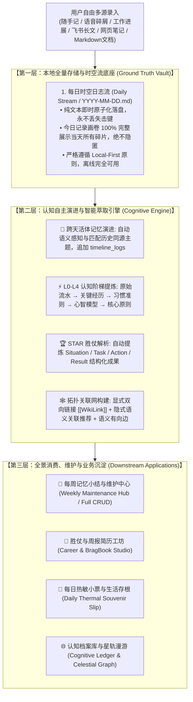
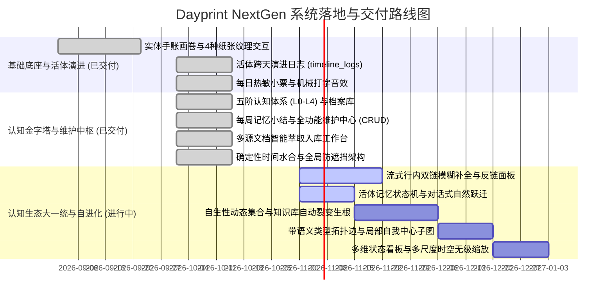

# Dayprint NextGen — 产品需求与系统架构全景文档 (PRD)

**产品全称：** Dayprint NextGen (智能活体记忆工坊与个人生活档案馆)  
**文档版本：** v3.2 (Dynamic Collections & Status-Aware Cognitive Edition)  
**更新日期：** 2026年10月  
**核心定义：** 基于实体手账排版、全息双向拓扑网络与自主认知进化引擎的本地优先数据主权工作区。  
**前沿演进：** 融合自生性动态集合 (Dynamic Collections)、活体记忆状态机 (Status State Machine)、多模态智能流转与无冲突大一统认知底座。  
**感官与视觉规范：** 莫兰迪矿物色彩体系 × 实体手账拼贴画卷 (Editorial Scrapbook) × 瑞士国际主义排版 × 4种物理纸张质感 × 机械打字机原生程序化音效

---

## 1. 产品愿景与设计理念 (Product Vision & Philosophy)

### 1.1 产品愿景
> **“Your life, in prints. 随手记、自动理、跨天活体演进、终身认知升维。”**

Dayprint NextGen 是面向知识工作者、独立创作者与终身学习者的**“活体记忆工作区（Living Memory Workspace）”**。

它从根本上重塑个人笔记与生活记录体验：
1. **拒绝“记完即弃”的数字废墟**：传统笔记随手记下后便沉入故纸堆；Dayprint 通过时间轴、每日热敏存根、每周小结与星轨图谱，让过去的思考不断被重新发现与链接。
2. **打通“流水账”到“认知资产”的升维闭环**：通过自研 **L0-L4 五阶认知进化体系**，自动将日常碎片升华为方法论、心智模型与人生信条。
3. **实现“同一主题跨天活体演进”**：通过内置的 `timeline_logs` 架构与智能语义感知横幅，记录新进展时自动归并至历史同源记忆，呈现生动年轮。

### 1.2 核心设计原则 (Product Principles)
1. **工作空间即画卷 (Dashboard First)**：首页即完整工作空间，拒绝多层深度嵌套的页面迷宫；记录、浏览、筛选与图谱在一个视觉画卷内流动。
2. **当下居中，历史成册 (Center for Today, History in Slips)**：中央始终属于当下的心流与即时记录；历史沉淀则汇编为热敏小票存根与星轨图谱。
3. **本地优先与绝对数据主权 (Local-First & Data Sovereignty)**：数据永远完整属于用户本地纯文本文件（Markdown Vault），离线百分之百可用，支持一键无损同步至个人私有 GitHub 仓库。
4. **温润实体与手账触感 (Tactile Warmth & Living Scrapbook)**：告别冰冷生硬的几何框格与刺眼纯色，采用温润的莫兰迪矿物色、和纸胶带、火漆印章、拍立得贴图与机械击键音，赋予数字工具真实的物理实体触感。

---

## 2. 系统端到端架构与流水线 (System Architecture & Pipeline)

Dayprint NextGen 确立严谨清晰的**“三层单向数据生命周期（Three-Tier Life-Cycle Pipeline）”**：



### 2.1 技术栈总览 (Tech Stack)
- **前端核心与渲染**：Next.js 16.4 (App Router, Turbopack) + React 19 + TypeScript 5
- **视觉排版与动效**：Tailwind CSS v4 + Framer Motion + Lucide Icons + Canvas-Confetti
- **状态与本地持久化**：React Context API (`MemoryContext`) + LocalStorage + Node.js FS API
- **智能大模型支持**：Google Gemini 2.5 / Flash API (兼容 DeepSeek、OpenAI、本地 Ollama)
- **外部持久化集成**：GitHub REST API (基于 Personal Access Token 的个人私有仓库无状态直接推送)
- **音频引擎**：Web Audio API 原生程序化音频合成 (零外部音频文件的机械键盘敲击音与纸张撕扯音)

---

### 2.0 空间导航拓扑 (Spatial Topology)

系统采用 **3 大主工作空间 + 4 大复盘与工具 + 1 大伴随面板** 的高内聚空间布局：

```
                    【Dayprint NextGen 空间导航拓扑】
                                   
      ┌─────────────────────────┬─────────────────────────┐
      │                         │                         │
      ▼                         ▼                         ▼
【今日记录 (daily)】       【认知档案 (memory_os)】   【关系图谱 (graph)】
  • 实体自适应记录流画卷      • L0-L4 五阶认知档案库     • 力导向星图关系网络
  • 今日流式记录台 (Editor)   • 白盒校准/晋升/编辑       • 双向拓扑连线与微观子图
  • 灵感便签签条 (Muse)       • 一键 AI 认知升维         • 同心圆引力轨道漫游
  • 右侧伴随面板 (Context)
      │
      └─────────────────────────┬─────────────────────────┘
                                │
                                ▼
               【复盘与工具 (Review & Tools)】
                 • 生活存根 (Life Stubs)
                 • 周度复盘 (Weekly Digest & Maintenance)
                 • 履历与成果库 (Career & Wins Studio)
                 • 历史档案 (Time Archive)
```

---

### 3.1 今日记录与流式记录台 (Today's Notes & Flow Editor)

#### 3.1.1 行业命名对标与设计原则 (Industry Naming Benchmark)
- **行业主流产品对标**：
  - **Apple Journal（苹果手账）**：一级入口定名为 **「日记 / 今天 (Journal / Today)」**；标题占位符为极简的 `Title (optional)`；正文占位符为 `Start writing...` 或智能灵感引导。
  - **Obsidian（黑曜石）**：核心入口统一命名为 **「每日笔记 (Daily Notes)」**。
  - **Day One**：主页命名为 **「今日 (Today)」**，单篇条目默认无强迫标题，占位符为自然浅淡的 `Title (optional)`。
  - **Flomo（浮墨笔记）**：主输入区定名为 **「随想记录」**，占位引导语为 `记录想法... (What's on your mind?)`。
  - **Logseq / Roam Research**：一级主页定名为 **「每日日志 (Journals)」**。
- **命名去修饰化原则**：
  - 弃用过度文青或形式感过重的“今日画卷 (Memory Fragment)”，回归生产力与日常记录本源：中文统一采用 **「今日记录」**，英文采用 **「Today's Notes」**；
  - 标题占位符采用低心智门槛的 `简短标题（选填）...` / `Title (optional)...`；
  - 正文输入引导语采用贴近日常交流的 `随手记下此刻的想法、灵感或生活碎片...` / `What's on your mind? Jot down a quick thought, link, or moment...`。

#### 3.1.2 实体手账记录流 (Editorial Scrapbook Stream)
- **自然呼吸的瀑布流排版**：采用自适应多列瀑布流（`columns-1 sm:2 md:3 xl:4 2xl:5`），卡片根据内容文本长短自然舒展，绝不强行限制卡片高宽或生硬截断文字（No Line-Clamp）。
- **4 种物理纸张纹理切换**：
  - **点阵纸 (Dot Grid)**：适合灵感发散与自由速写；
  - **方格纸 (Graph Paper)**：适合逻辑梳理与技术记录；
  - **横线纸 (Ruled)**：适合反思手记与长篇随笔；
  - **纯白纸 (Plain)**：极简专注阅读体验。
- **实体手账细节微交互**：
  - 卡片顶部附带**实体和纸胶带 (Washi Tape)** 装饰；
  - 底部配有**邮戳编号 (`#xxxx`)** 与打卡印章；
  - 鼠标悬停卡片时具有轻微角度摆动（`tilt`）与阴影加深效果；
  - 关联卡片触发**拓扑磁吸光环 (Magnetic Aura)** 与聚焦标签。

#### 3.1.2 极速流式记录台 (Today Flow Editor)
- **渐进式呼吸展开 (Progressive Disclosure & Vertical Space Saver)**：
  - 默认状态呈现极简打字行（`随手记下此刻的想法、灵感... (按 ↵ 展开)`），高度仅 44px；
  - 聚焦输入或草稿激活时平滑展开全景记录台；支持一键「收起」，保存后自动折叠，首屏瀑布流卡片露出率提升 40% 以上。
- **时间与日期精确控制 & 历史补记状态感知 (Backfill Alert Banner)**：
  - 默认锚定为当天与当前时刻，提供一键 `now` 重置为当前时间戳；
  - 若用户手动调整日期为过去某天（历史补记模式），记录台顶部自动浮现温润的琥珀色感知横幅：`📅 正在补记 YYYY-MM-DD 的回忆碎片（将自动同步至当日存根小票）`，并附带 `[一键切回今天]` 快捷按钮，彻底消除用户心智上的时空认知错乱。
- **双语双轨草稿与翻译**：
  - 支持中英文独立草稿切换，附带绿点即时感知草稿状态；提供一键自动互译与中英文双语补齐。
- **长笔记/外部文档一键萃取入口**：
  - 记录台顶部提供「萃取长笔记/文档」快捷入口，呼出智能切片弹窗。
- **跨天活体演进智能建议横幅 (Evolution Banner)**：
  - 用户打字时，AI 语义感知引擎实时扫描历史记忆库；
  - 若命中历史同源卡片，自动展示翠绿横幅，显示历史已演进次数，支持一键切换「自动演进归并」或「保持独立新记忆」。
- **时空记忆回响与因果连线双向切换 (Serendipity Weave & Unweave)**：
  - 输入时若触发历史记忆回响（伏笔），底端展示金黄色回响条与一键「编织因果连线 (Weave Echo)」；
  - **支持随时撤回取消**：连线状态全面支持 Toggle 双向切换，已连线状态下鼠标悬停即刻提示「取消连线 (Cancel Link)」，点击即可一秒撤回，彻底解决误点后无法取消的死锁问题，保存时才将真实关系双向落地。
- **富文本轻量语法支持**：
  - 行内支持 `#` 标题、`[]` 待办清单、`>` 手账高亮块、`>>>` 详情折叠块、`**加粗**`、`==高亮==`。
- **拍立得相纸贴图**：
  - 支持点击上传或直接 `Cmd+V` 粘贴图片，客户端秒级无损压缩，卡片以拍立得便签纸质感贴附展示。
- **类型色彩专属绑定 (Type Palette Picker)**：
  - 强绑定莫兰迪 10 种矿物色彩；点击弹出向右延展的拾色器，支持就地修改并全局实时同步。
- **快捷键直达**：支持 `⌘ + Enter` 盲打秒级保存，配合纸花微交互与机械击键音。

#### 3.1.3 实体手账卡片微标与纯净画卷模式 (Zen Canvas & Cognitive Badging)
- **L0-L4 认知阶梯印章外显**：每张卡片顶部实时展示所属认知阶梯印记（`L0·流水`、`L1·经历`、`L2·习惯`、`L3·心智`、`L4·原则`），长青原则与胜仗（STAR）带有专属徽章。
- **GPU 硬件加速与防虚化渲染**：卡片摆动动画全面注入 `transform-gpu backface-hidden will-change-transform`，彻底杜绝亚像素字形模糊。
- **纯净画卷模式 (Zen Mode)**：HeaderBar 提供一键折叠右侧伴随面板（`PanelRightClose`），让主画布在单列到五列自适应展开，提供无干扰沉浸阅读体验。

---

### 3.2 认知档案库与五阶认知进化体系 (Cognitive Ledger & Memory OS)

在独立工作区 **「认知档案」** 中，系统严守“日记感知”与“认知沉淀”的分离准则，将散落的碎片系统化沉淀为五阶认知资产：

| 认知阶梯 | 行业标准命名 | 系统代码 | 核心定义 | 典型内容与业务流向 |
| :--- | :--- | :--- | :--- | :--- |
| **0 阶** | **原始日志 (Raw Stream)** | `L0` | 瞬时灵感、情绪流水与工作现场记录 | 随手记随笔、会议碎片、未经加工的每日输入流水（全量沉淀底座） |
| **1 阶** | **关键经历 (Key Events)** | `L1` | 具有里程碑意义的真实战果与项目经历 | 达成里程碑、解决重大事故、攻坚核心功能（流向职场述职工坊） |
| **2 阶** | **习惯准则 (Habits & SOPs)** | `L2` | 经实践检验有效的个人工作法与偏好 | 技术排查规范、调试 SOP、高频工具偏好、健康作息习惯 |
| **3 阶** | **心智模型 (Mental Models)** | `L3` | 洞察事物本质的高阶思维框架与决策透镜 | 第一性原理推导、逆向思考法、系统动力学认知模型 |
| **4 阶** | **核心原则 (Core Principles)** | `L4` | 终生信奉的根本价值观与处事底线原则 | 价值取向、根本信念、不可妥协的底线准则（最高认知准则） |

- **白盒校准与就地编辑**：用户可在此工作区清晰查看每个层级的沉淀数量，直接修改认知层级（L0~L4）、置信度与主题标签。
- **一键 AI 认知升维 (AI Distill Engine)**：调用认知反思模型，研读历史碎片，自动输出高阶特质与信条候选，用户确认后一键升维入库。
- **强溯源保障**：每一条沉淀特质保留 `source_id`，支持一键反查回当天的原始日记上下文。

---

### 3.3 关系图谱与星轨引力拓扑 (Knowledge Graph & Celestial Topology)

#### 3.3.1 全景力导向关系网络 (Force Graph Canvas)
- **显式双向链接 (`[[WikiLink]]`)**：支持正文输入 `[[` 实时模糊搜索补全；支持反向链接面板（Backlinks）与未链接提及（Unlinked Mentions）一键转化为双链。
- **带语义与权重的拓扑边**：支持 `causes`（因果/触发）、`derives_from`（演进/衍生）、`references`（参考/引用）、`supports`（佐证）等显式语义边。
- **节点层级防溢出与视觉区分**：
  - 节点尺寸与星核辉光严格对应 L0-L4 层级；
  - 节点前置标识规范为 2 字中文（`流水`、`经历`、`习惯`、`心智`、`原则`）；
  - 节点内部强制注入 SVG `<clipPath>` 物理边界，杜绝超长标题文字外溢。
- **视图控制**：提供放大、缩小、重置视图、一键全景居中（Fit All Nodes）与全图透视高亮。

#### 3.3.2 星轨同心圆漫游 (Celestial Walk)
- 以同心圆引力轨道将记忆按时空跨度（晨间意图、午后聚焦、夜间沉淀、历史周期）呈现在天体轨迹上，提供沉浸式宇宙漫游交互。

---

### 3.4 右侧伴随面板：双模块解耦与时序热力图 (Context Panel)

右侧面板采用清晰的**双模块解耦架构**：

1. **今日时间流 (Today's Stream & Timeline)**：
   - 内部封装独立的物理滚动容器（`overflow-y-auto flex-1`），无论今日沉淀 3 条还是 30 条碎片，均在自身视口内自滚动，绝对不撑大或拉变形侧边栏。
   - 每条碎片卡片展示发生时间、类型色彩条、标题摘要与删除快捷键。
2. **今日生活存根与复盘工作区 (Daily Life Stub & Reflection Widget)**：
   - **主页就地复盘 (In-Context Reflection)**：直接在主页右侧面板提供今日复盘与晚安结语输入框，告别弹窗脱节感，随手写下当日感悟并实时自动存盘至生活存根数据模型中。
   - **主页心情水彩选择器 (Mood Wash Selector)**：提供 5 色专属莫兰迪矿物色彩微标（陶土红、琥珀蜜、苍青绿、冰海蓝、暮山紫），点击即选，联动当日生活存根渐变浸染。
   - **一键查阅 / 导出生活存根**：快捷唤起实体生活存根全屏画卷。
3. **每周小结与维护卡片 (Weekly Digest Widget)**：
   - 展示本周记忆治理入口，一键打开每周小结弹窗。
4. **时序记忆活跃度热力图 (Memory Activity Heatmap & GitHub Logic Alignment)**：
   - **对齐 GitHub 标准贡献图规范**：
     - **未来日期隐形化 (Future Days Invisible)**：当前周内今天之后的格子（未来天）保持透明空白，杜绝将“尚未发生的未来”画成灰色未打卡格子的认知违和；
     - **月份时间轴标尺 (Month Headers)**：顶部沿周列动态展示月份刻度（如 `8月`、`9月`、`10月`），时间维度一目了然；
     - **时区安全防偏移**：基于本地 `YYYY-MM-DD` 纯字符串直接切片映射，彻底消除 UTC 转换导致的打卡日期往后或往前飘移 1 天的 Bug；
     - **支持点击任意历史天（含空白天）**：点击任何格子均可精准切换焦点日期；若是空白天，自动联动主页顶部唤起「📅 正在补记该日」横幅；
     - **焦点选中微交互**：保留原有莫兰迪绿色彩阶密度，通过外圈深色环形光标（`ring-2 ring-stone-900 ring-offset-1`）标示选中态，不再突兀变色。
   - **阶梯色彩**：未记录呈现浅纸灰（`#E7E5E4`），记录密度呈现莫兰迪墨绿阶梯（`#608066`）；
   - **核心指标**：自动计算 `Streak` 连续打卡天数（附带矢量火焰橙色徽章）、总记录天数与总沉淀数。

---

### 3.5 复盘与工具箱 (Review & Tools Modals)

1. **生活存根画卷 (Life Stubs Archive)**：
   - **统一分段 Tab 导航 (Unified Segmented Tabs)**：顶部日期选择器采用与全局一致的圆角分段胶囊设计（`Segmented Control`），支持自然切换历史记录日期，高亮焦点日并以莫兰迪小红点标识已归档存根。
   - **纯粹展示用户所选心情 (Selected Mood Only)**：存根卡片仅呈现用户在主页选择的专属情绪水彩药丸（`Mood Wash`），拒绝问卷式铺陈所有选项，底部以水彩渐变微浸染（Dip-Dye Gradient）自然烘托。
   - **主页复盘内容实体印刻**：自动将用户在主页填写的复盘结语以复古印刷体（Serif Italic）印刻在生活存根底端，配有微锯齿撕纸与复古火漆印章动画。
   - **交互与功能**：支持一键保存归档、高精度打印机排版格式化输出与在主页「今日记录」中精准定位展开。
2. **每周记忆小结与维护中心 (Weekly Digest & Maintenance Hub)**：
   - 按周漫游回溯历史周度沉淀。
   - 本周更新看板：量化记录总数、打卡天数与 L0-L4 认知分布柱状图。
   - 记忆全生命周期 CRUD 治理：支持查、增（本周补记）、改（右侧抽屉就地编辑）、删（二次确认）。
   - 一键生成排版工整的标准周报 Markdown 并复制剪贴板。
3. **胜仗与周报简历工坊 (Career & BragBook Studio)**：
   - **硅谷 Brag Document 方法论体系**：自动捕获所有标记为【工作胜仗】、关键经历 (L1) 与技术攻坚的记忆脉冲，终结述职与跳槽时“想不起自己做了什么”的痛点。
   - **多模型原生直连引擎 (Full Multi-Provider AI Architecture)**：
     - 本地环境默认直连 Antigravity 的 Google Gemini 3.8 / 2.5 Flash 极速模型（无缝秒级响应）；
     - 支持用户在「设置」中自主填入 API Key 与自定义端点，全量打通 **Google Gemini、OpenAI (GPT-4o/mini)、Anthropic Claude (3.5 Sonnet/Haiku)、DeepSeek (Chat/Coder) 及 Custom OpenAI 兼容中转**；
   - **全流程 AI 深度提炼与 STAR 转换**：
     - **一键深度述职周报生成**：通过大模型结构化生成包含“核心交付、技术攻关与难题突破、业务收益与量化影响、下阶段推进”的 Executive 级别周报；
     - **STAR 简历亮点与面试库提取**：AI 自动从口语化流水记录中抽离 Situation、Task、Action、Result 四大关键因子，并输出强动词开头的精练简历 Bullet Points，支持一键复制与 Markdown 导出；
     - **胜仗账本 (Wins Ledger)**：按时间范围（本周、近14天、本月、全部胜仗）清晰卡片化陈列所有战果，记录演进次数与关键标签。
4. **长笔记与多源文档智能萃取工作台 (Smart Note & Document Ingestion)**：
   - 支持长文直接粘贴、飞书在线文档链接提取、`.docx` / `.md` / `.txt` 本地文件拖拽解析。
   - AI 认知切片为 2~6 张独立原子卡片，自动生成同源关联边，批量入库。
5. **时光归档 (Time Archive)**：
   - 提供按年份、月份快速穿梭过滤，回溯过往岁月轨迹。

---

## 4. 全局工程标准与架构规范 (Engineering Standards)

### 4.1 全站确定性时间渲染规范 (Deterministic Hydration Protocol)
- **根因**：Next.js 16 SSR 阶段 Node.js 运行时（服务端）与客户端浏览器的时区和语言环境存在差异，使用 `toLocaleDateString` 等函数必然引发水合不一致报错（`Hydration failed`）。
- **规范**：
  - 严禁在组件渲染中直接调用本地环境时间函数；
  - 统一采用纯字符串安全截取格式化算法 [`formatDisplayDate`](file:///Users/katherine/Desktop/play&fun/build-with-AI-basics/src/types/memory.ts#L10) 与 [`formatDisplayTime`](file:///Users/katherine/Desktop/play&fun/build-with-AI-basics/src/types/memory.ts#L22)，通过切片提取 `YYYY-MM-DD` 与 `HH:mm`；
  - 日期渲染节点统一配置 `suppressHydrationWarning`，达成端到端零水合警告。

### 4.2 浮层智能锚定与全局 Z-Index 层叠规范 (Non-Occlusion Architecture)
- **浮层向右安全延展**：
  - 输入框内所有小浮层（如「类型色彩」拾色器）一律配置 `left-0 bottom-full mb-2 w-60 max-w-[calc(100vw-3rem)]`，杜绝因 `right-0` 导致的向左穿透遮挡；
  - 挂载 `fixed inset-0 z-40` 透明遮罩，实现优雅的点击外部平滑收起。
- **全站统一 Z-Index 阶梯矩阵**：
  - `Z-0 ~ Z-10`：画布底色、纸张纹理网格、平铺卡片流（Hover 聚焦态升为 `Z-20`）
  - `Z-20`：主画布粘性控制带（Filter & Sort Ribbon）
  - `Z-30`：页面顶部全局导航条（Sticky HeaderBar）
  - `Z-[35]`：移动端侧边栏暗色背景遮罩（Mobile Backdrop）
  - `Z-40`：移动端抽屉式侧边栏（Mobile Sidebar Drawer）
  - `Z-50`：行内独立弹层与拾色器（Editor Inline Popovers）
  - `Z-[60]`：全屏沉浸式模态弹窗（Weekly Digest、Thermal Receipt、Career Studio、Archive、Constellation、Ingest Modal）
  - `Z-[70]`：全局快捷检索浮层（OmniSearch `⌘K`）

### 4.3 瀑布流抗抽动排版准则 (Anti-Jitter Masonry Principles)
- 多列瀑布流（`columns-N`）布局内，卡片容器**严禁使用动态改变高度的子 DOM 节点插拔**，严禁使用导致相邻列外边距重算的 `space-y-N`；
- 统一使用独立的 `mb-5 break-inside-avoid [break-inside:avoid-column]`；
- 卡片 Hover 状态仅采用硬件加速合成器属性（`opacity`、`box-shadow`、`border-color`），杜绝页面卡片抖动与跳跃。

### 4.4 开发调试层完全静默规范 (Dev Indicator Elimination)
- 在 `next.config.ts` 中配置 `devIndicators: false`；
- 在 `globals.css` 中注入针对 `nextjs-portal`、`[data-nextjs-dev-indicator]` 的物理级 CSS Killswitch，消除屏幕左下角一切外部框架标志侵入。

---

## 5. 核心数据模型规范 (Canonical Data Schema)

系统核心数据结构在 [`src/types/memory.ts`](file:///Users/katherine/Desktop/play&fun/build-with-AI-basics/src/types/memory.ts) 中严密定义：

```ts
export type MemoryType =
  | "idea"       // 灵感
  | "learning"   // 思考 / 学习
  | "moment"     // 生活微光 / 瞬间
  | "decision"   // 决策
  | "plan"       // 计划
  | "collection" // 收藏
  | "receipt"    // 小票存根
  | "fact"       // 事实经历
  | string;      // 用户自定义扩展类型

export type MemoryLevel = "L0" | "L1" | "L2" | "L3" | "L4";

export interface TimelineLog {
  id: string;
  timestamp: string; // ISO 8601
  note_zh: string;
  note_en?: string;
  source?: "manual" | "ai_merge" | "doc_ingest";
}

export interface CanonicalMemory {
  id: string;                    // 唯一标识符，格式：mem_<timestamp>_<random>
  title: string;                 // 默认标题
  title_zh?: string;             // 中文标题
  title_en?: string;             // 英文标题
  content: string;               // 默认正文
  content_zh?: string;           // 中文正文
  content_en?: string;           // 英文正文
  type: MemoryType;              // 记忆类型
  memory_level: MemoryLevel;     // 五阶认知层级 (L0-L4)
  confidence?: number;           // 认知沉淀置信度 (0.0 ~ 1.0)
  topics: string[];              // 标签列表
  occurred_at: string;           // 发生时间 (ISO 8601)
  created_at: string;            // 创建时间 (ISO 8601)
  updated_at: string;            // 更新时间 (ISO 8601)
  media_url?: string;            // 附件图片 (Data URL 或远程路径)
  color_accent?: string;         // 专属莫兰迪绑定色 (HEX)
  timeline_logs?: TimelineLog[]; // 活体跨天演进脉络日志
  source_id?: string;            // 来源溯源锚点 ID
  provenance: {
    capture_method: "manual" | "ai_distill" | "doc_ingest" | "camera";
    ai_generated?: boolean;
    extracted_from_doc?: string;
  };
}

export interface Relationship {
  id: string;
  from_memory_id: string;
  to_memory_id: string;
  relationship_type: "causes" | "derives_from" | "references" | "supports" | "contradicts" | "linked";
  strength?: number;             // 0.0 ~ 1.0 关联强度权重
  created_at: string;
}
```

---

## 5. 架构决策与产品定位聚焦 (ADR & Focus Protocol)

### 5.1 上下游生态全景与数据主权闭环 (Upstream & Downstream Topology)

针对输入捕获与多端同步，系统严格遵循 **“已存在的轮子坚决不重写 (YAGNI & Reuse First)”** 的资深极简架构原则。不重新在网页端造一套笨重的录音与跨端客户端，而是与用户的现有成熟数字资产链条实现**天然无缝咬合**：

```
┌─────────────────────────────────────────────────────────────┐
│ 1. 移动端/全场景即时捕获层 (Ambient Capture Layer)          │
│    • 飞书客户端 (Feishu App / You+ Bot)                      │
│    • 随时随地语音倾诉、图文随手记、外部链接投递              │
└──────────────────────────────┬──────────────────────────────┘
                               │ (已在 digital-sub-myself 中打通)
                               ▼
┌─────────────────────────────────────────────────────────────┐
│ 2. 统一文件底座与版本主权层 (Canonical Vault & Git Sync)     │
│    • 本地 Obsidian Vault (01_Persona ~ 05_Reading_Notes)    │
│    • GitHub 私有仓库自动推送 (Zero-Vendor Lock-in)          │
└──────────────────────────────┬──────────────────────────────┘
                               │ (本地 FS API / GitHub REST API 极速热同步)
                               ▼
┌─────────────────────────────────────────────────────────────┐
│ 3. 触感美学呈现与认知交付中枢 (Dayprint NextGen)             │
│    • 【极简呈现】今日记录画卷、生活存根、莫兰迪水彩情绪印刻  │
│    • 【认知升维】L0-L4 阶梯化提炼 (习惯、心智模型、底层原则) │
│    • 【关系拓扑】力导向双向连线星图与知识词条               │
│    • 【成果外溢】STAR 工作胜仗、智能周报与述职报告输出       │
└─────────────────────────────────────────────────────────────┘
```

---

### 5.2 核心架构决策与功能剪枝清单 (Architecture Decisions & Pruning)

| 决策点 | 评估与结论 | 架构考量与 Rationale |
| :--- | :--- | :--- |
| **1. 语音转写与速记** | **坚决不自研网页录音**<br>直接复用飞书 You+ 管道 | 用户在现有 `digital-sub-myself` 项目中已打通飞书 You+ 机器人与 Obsidian。在手机/手表飞书发语音更符合自然习惯，直接写入本地并同步 GitHub，零重复建设。 |
| **2. 系统全局快捷键** | **判定为 YAGNI (剪枝废弃)**<br>依赖飞书对话框 | 飞书常驻后台与多端提醒，发消息给 Bot 比专门维护一套桌面端快捷键守护进程更轻量、更可靠。 |
| **3. 沉睡记忆打捞/漫步** | **判定为过度设计 (剪枝废弃)**<br>保留精准检索与看板 | 强制“随机漫步”或强推通知容易打扰用户心流；用户更需要的是在周复盘与成果工坊中目标明确地调阅与沉淀。 |
| **4. 环境元数据与画册印刷** | **判定为非核心复杂度 (剪枝废弃)**<br>专注真实个人资产 | 天气、地理定位等传感器数据不构成记忆核心；Dayprint 当前重点是把数字分身的数据管理、认知提炼与职场交付做到极致。 |

---

### 5.3 Dayprint NextGen 的纯粹定位 (Pure Core Value)

经过本次穿透与剪枝，Dayprint 的核心定位彻底聚焦为：  
**「基于飞书与 Obsidian 数据流的个人数字分身美学中枢与认知交付工坊」**。

它不再试图做一个平庸的“大而全全能笔记”，而是专注于做竞品做不到、但用户最离不开的四大核心长板：
1. **触感实体温润美学**：让冷冰冰的 Markdown 笔记，变成可翻阅、可浸染、有锯齿撕纸与火漆印章的「生活存根」与「今日画卷」；
2. **高阶认知阶梯提炼**：利用本地 Gemini 模型，自动将飞书/Obsidian 涌入的海量碎片，蒸馏为有复利价值的心智模型与底层原则；
3. **概念网络双向星轨**：基于 [[Wiki-Links]] 构建交互式力导向全息星图，洞察知识盲区与因果脉络；
4. **职场胜仗与交付闭环**：一键从碎屑中提炼 STAR 工作战绩，无缝生成高情商的工作周报与晋升述职报告。

---

### 5.4 存储格式兼容性与同步隔离机制 (Storage Formats & Safe Sync Protocol)

针对用户关心的“Feishu -> Obsidian -> GitHub -> Dayprint 是否真正打通？是否存在存储格式冲突？”，系统已完成端到端落地并确立严格的安全边界：

1. **GitHub 云端单一真实源打通 (GitHub as the Single Cloud Source of Truth)**：
   - **架构解耦**：彻底杜绝 Dayprint 依赖本地私有文件路径（`/Users/...`）。Dayprint 将用户自有的 GitHub 远端私有仓库（如 `your-username/my-dayprint-vault`）作为唯一核心云端中枢；绝不预填任何写死假数据或第三方仓库名；
   - **Demo 模式免门槛体验与非持久化声明**：若用户暂无 GitHub 账号或 Token，系统引导其切换至 Demo 演示模式体验完整交互特性；同时在全链路（欢迎网关、偏好设置、模式切换菜单）强提示：**“Demo 模式仅供交互评测与体验，无法持久化存储用户个人信息与手账数据”**；
   - **全面双语国际化 (i18n)**：所有设置弹窗、API Key 说明、占位符及模型选项严格适配中英双语，杜绝在英文模式下残留中文文本。
   - **直接拉取与同步**：Dayprint `/api/github/sync` 直连 GitHub REST API，自动并发拉取远端仓库的 `vault/` 目录中由 Obsidian/飞书推送的所有 Master Notes（`01_Persona ~ 05_Reading_Notes` 等），经由 `vault-parser` 纯内存无损解析为 Canonical Memory 资产；
   - **双轨无缝流转**：Obsidian 与 Feishu 负责向 GitHub 推送更新，Dayprint 前端每 20 秒及窗口聚焦时自动静默比对 GitHub 远端变更，实现跨设备、跨网络环境的云端实时无缝打通。
2. **存储格式映射与零破坏原则 (Markdown vs. JSON Zero-Loss & Non-Destructive)**：
   - **Obsidian 侧**：原生保持纯纯粹粹的 Markdown（YAML Frontmatter + `##/###` 标题 + `- [ ]` / `- 列表`），遵循人类可读与 Git diff 友好原则；
   - **Dayprint 侧**：自动解析并升维映射为严谨的 JSON 状态机模型（附带 `schema_version`、`memory_level: L0~L4`、`topics`、`relations`、`timeline_logs`）；
   - **单向读取物理隔离**：Dayprint **绝不对本地 Obsidian `.md` 原文件执行任何反向改写或覆写**。Dayprint 的富文本编辑、情绪水彩、火漆印章等状态仅保存在浏览器 LocalStorage 与 GitHub 的 `dayprint-memory/archive.json` 中，从根源上 100% 杜绝了自动化脚本意外破坏用户 Obsidian 笔记的风险。
3. **GitHub 仓库目录无冲突并存 (Repo Topology)**：
   - `vault/*.md`：由 `digital-sub-myself/git_sync.py` 负责维护与版本推送；
   - `dayprint-memory/archive.json`：由 Dayprint GitHub Sync API 独立维护与提交；
   - 两者同处于一个 GitHub 仓库但互为独立目录分支，互不干扰、互不覆写。
4. **主体归属与认知防污染协议 (Provenance & Attribution Isolation)**：
   - **核心边界**：严格区分「自传体亲身经历 (Episodic Personal Wins)」与「外部架构学习案例 (Semantic External Benchmarks)」；
   - **防伪造拦截**：当用户输入包含“这是人家的架构/别人做的/学习提炼一下”等提示词时，记忆引擎严禁生成以用户为主语的 STAR 工作经历，坚决不写入 `02_Work_and_Projects.md`；
   - **专用通道分流**：外部系统拓扑自动归档入 `03_Learning_and_Skills.md` 的「## 🏗️ 业界架构参考与设计模式」分区，保留系统拓扑图（Mermaid）、核心亮点、设计权衡及复用启示，彻底消除述职胜仗账本的虚假数据污染。
5. **首次访问欢迎网关与多租户 BYOR 记忆隔离规范 (Welcome Gateway & Multi-Tenant BYOR Isolation)**：
   - **进站智能分流 (`WelcomeGatewayModal`)**：初次访问 Dayprint 时，页面自动弹出双轨欢迎网关：
     - **路径 A (正式专属手账)**：引导用户输入个人 GitHub PAT 与私有仓库名（默认 `my-dayprint-vault`，不存在时自动建库），无中心数据库，物理级私有隔离；
     - **路径 B (Demo 体验模式)**：一秒载入蒙德里安图谱、生活小票存根与示例认知档案，零门槛沉浸式体验全部交互；
   - **防串流安全底线**：默认设置与服务端绝对禁止硬编码任何开发者个人凭证与仓库名；每位用户的 Token 与手账记忆严格在当前设备 `localStorage` 和其个人 GitHub 私有仓库中流转，100% 杜绝多用户之间的数据干扰与记忆污染。

### 5.5 多模态外链三阶路由与待读/求职待办闭环 (Multi-Modal Link Routing & Ingestion)

针对外部链接摄取，系统确立 **“显式意图优先 ➔ 域名特征嗅探 ➔ 智能默认归入稍后再读”** 的三阶漏斗管道：

1. **求职投递雷达管道 (Job Application & Radar Pipeline)**：
   - **触发判定**：招聘平台域名（Boss直聘、LinkedIn、拉勾、猎聘、Greenhouse、Lever 等）或随附文字包含 `投递/岗位/职位/求职/JD/招聘`；
   - **沉淀动作**：解析职位 JD、薪资地点、核心技术栈，由 AI 生成针对 Katherine 的匹配优势与简历侧重点；
   - **存储流向**：写入 `02_Work_and_Projects.md` 下的 `## 🎯 机会雷达与投递待办`（带 `- [ ]` 待办状态），并同步至 Dayprint 简历工坊的机会雷达池。
2. **深度提炼研报管道 (Deep Distillation Pipeline)**：
   - **触发判定**：随附文字明确包含 `提炼/总结/拆解/分析/核心观点/架构`；
   - **沉淀动作**：深度抓取正文，运行高阶认知切片（核心论点 + 3 关键推论 + 心智模型 + 迁移启示）；
   - **存储流向**：写入 `03_Learning_and_Skills.md`（L2/L3 级认知），同步至 Dayprint 知识图谱生成拓扑节点。
3. **通用域名轻量摘要与稍后再读闭环 (Read-Later by Default with Lightweight Teaser)**：
   - **用户偏好核心规则**：**所有未带明确指令的内容类链接与通用域名链接，经轻量摘要与交互确认后，一律自动归档入「稍后再读清单」**；
   - **沉淀动作**：零依赖提取网页标题、描述与干净正文，评估字数并计算预估阅读时长，由大模型生成 2~3 句高信息密度导读速览（Teaser）；
   - **存储流向**：写入 `05_Reading_Notes.md` 下的 `## ⏳ 待读清单 (Read Later)`（带 `- [ ]` 待办标记），Dayprint 自动打上莫兰迪 `#read-later` 标签；
   - **交互确认**：飞书端卡片回复速览并标明已归档待读，文末提供快捷引导（“回复「提炼」可随时升级为深度研报”），彻底兼顾零打扰与随时深挖。

### 5.6 动态集合与自生性分类规范 (Dynamic Collections & Auto-Sprouting Taxonomy)

为了彻底根除“人工维护分类树”的僵化与高摩擦成本，系统引入源自 Mem.ai 与 Dot 的**自生性动态集合（Dynamic Collections）**机制：

```
                        【自生性动态集合 (Dynamic Collection) 演进模型】

  [原始碎片涌入] ──────► [开放式原子打标 (Open Topics)]
                            • 绝不强迫归入已有固定文件夹
                            • 自由提炼细粒度话题词 (如: '手冲咖啡', '萃取参数')
                                    │
                                    ▼
                          [聚类密度流式感知]
                            • 窗口期内频次 >= 3 且语义高度聚拢
                            • 自动识别为高潜新知识脉络 (Emerging Concept)
                                    │
                                    ▼
                          [知识树自动裂变生根 (Auto-Sprouting)]
                            • 自动在 Vault 中生成新 Master Note (07_Coffee_Craft.md)
                            • 自动迁移收拢历史碎片，平滑晋升为独立动态集合
                            • Dayprint 前端自动点亮专属莫兰迪主题胶囊
```

1. **底层开放标签与分类解绑 (Unbounded Tagging)**：
   - 记忆入库时，LLM 只做语义提炼与开放式打标（`topics: string[]`），不再强行截断为固定的枚举分类。
   - 保留初始基石文件（01_Persona ~ 05_Reading）作为系统初始化母体，但不设物理上限。
2. **主题涌现与裂变检测 (Emergence Detection Engine)**：
   - 后台运行轻量级主题频次与密度监视器。当未归档入特定专门集合的某一话题簇在短周期内被连续记录达到阈值（如 $\ge 3$ 次），系统将其判定为“新兴探索领域”；
   - 触发 LLM 进行**主题综合命名（Topic Induction & Title Synthesis）**，生成典雅的领域中英文名称及适用范围。
3. **知识库自动生根与迁移 (Auto-Sprouting & Seamless Ingestion)**：
   - 自动在 Obsidian Vault 中创建新的结构化集合文件（例如 `07_Coffee_and_Tasting.md` 或 `08_Crypto_Quant_Research.md`）；
   - 将之前分散在收件箱或零散流水中的相关碎片，自动提取并追加进新集合文件的上下文大纲下；
   - **Dayprint 前端自适应**：前端视图自动增加该 `collection` 过滤器，赋予专属莫兰迪色谱，并提供一键重命名或合并归整的能力。

---

### 5.7 活体记忆状态机与全生命周期流转 (Status-Aware Cognitive Memory)

记忆不是一具具冰冷的静态文本，而是带有明确执行进度与现实演进脉络的**活体状态机（Status State Machine）**。借鉴 Dot 与 Stanford Generative Agents 的前沿认知模型，每一条记忆条目均附带严谨的生命周期状态：

| 记忆状态代码 | 状态名称与含义 | 适用场景与内容特征 | 在 Dayprint 与飞书的交互表现 |
| :--- | :--- | :--- | :--- |
| `ongoing` | **进行中 / 探索中** | 正在学习的新技能、正在推进的项目、长线生活尝试 | 附带绿色微光脉冲呼吸灯；飞书在适当时机进行温和回响跟进 |
| `completed` | **已达成 / 胜仗落地** | 成功交付的项目、攻克的难关、已掌握的技术栈 | 盖有「胜仗」火漆印章；自动无缝推送至 STAR 履历工坊作为述职弹药 |
| `paused` | **暂停搁浅 / 备忘** | 因外部客观条件暂时搁置的探索或研究 | 呈现柔和琥珀灰滤镜；周复盘时提示是否需要重启或彻底归档 |
| `abandoned` | **已弃置 / 证伪反思** | 尝试后证明不可行、放弃的路线或被证伪的假设 | 保留失败经验与复盘反思（避坑指南），但不污染有效生产力看板 |
| `read_later` | **稍后再读** | 外部投递的优质文章、研报、通用网页链接 | 带有待读复选框 `- [ ]`；支持一键转为深度研报或标记为已读 |
| `action_item` | **行动待办 / 机会雷达** | 需跟进的招聘职位投递、约定事项、待办备忘 | 高亮黄色待办徽标；流向机会雷达待办流与任务看板 |
| `evergreen` | **长青准则 / 金科玉律** | 永不过期的底层心智模型 (L3) 与核心原则 (L4) | 黄金星核辉光印刻；永久置顶于认知档案库顶层，作为决策透镜 |
| `superseded` | **已被迭代 / 历史快照** | 随认知升级被更新结论所覆写的旧版本记忆 | 标记为历史归档，附带 `supersedes_id` 溯源指针，杜绝上下文相互掐架 |

- **对话式自然状态跃迁（Zero-Friction In-Chat Transition）**：
  - 用户在飞书交流中输入：“那篇多智能体的文章我已经读完了”、“Svelte 的项目今天上线了”、“那个投资计划放弃了，风险太大”；
  - 记忆引擎智能识别状态谓词，精准反查目标记忆，将其状态就地从 `ongoing` / `read_later` 跃迁为 `completed` / `abandoned`，并同步更新 Obsidian 与 Dayprint。

---

### 5.8 前沿记忆生态融合与无冲突协同架构 (Unified Non-Conflicting Evolution Matrix)

为确保 **Dynamic Collection（自生集合）**、**Status State Machine（活体状态机）**、**多模态外链分流**、**Obsidian 本地主权底座** 与 **Dayprint 美学画卷** 各模块自洽共生、绝不冲突，系统确立严格的正交解耦维度：

```
┌──────────────────────────────────────────────────────────────────────────────────┐
│              Dayprint NextGen & You+ 前沿认知记忆架构大一统矩阵                    │
├───────────────────┬──────────────────────────────────────────────────────────────┤
│ 1. 现实生命维度    │ 状态机 (Status): ongoing ➔ completed ➔ paused ➔ abandoned    │
│    (What's its state?) │ 负责感知事情“办到哪一步了”，驱动任务闭环与行为跟进        │
├───────────────────┼──────────────────────────────────────────────────────────────┤
│ 2. 领域知识维度    │ 动态集合 (Dynamic Collection): 自动涌现生长的知识主题簇     │
│    (Where does it live?)│ 负责知识“属于什么专业领域”，免去人工建文件夹的繁重心智负担 │
├───────────────────┼──────────────────────────────────────────────────────────────┤
│ 3. 认知抽象维度    │ 五阶阶梯 (L0-L4): 原始流水 ➔ 关键经历 ➔ 习惯 ➔ 心智模型 ➔ 原则 │
│    (How deep is it?)   │ 负责智慧“升华到什么认知高度”，驱动长期复利与决策升维      │
├───────────────────┼──────────────────────────────────────────────────────────────┤
│ 4. 存储与呈现维度  │ Obsidian Vault (纯文本 Markdown 地基) × Dayprint (触感美学) │
│    (How is it stored?) │ 单向数据流，本地绝对主权，零破坏防污染，秒级 GitHub 备份  │
└───────────────────┴──────────────────────────────────────────────────────────────┘
```

**四大维度互为完全正交关系**：
- 一条记忆可以同时具备 `collection: "多智能体架构"`（领域维度）、`status: "completed"`（现实进度维度）、`memory_level: "L2"`（认知方法论维度）。
- 各模块各司其职：新增功能不需要推翻既有架构，而是像插件一样正交叠合，彻底消除了概念冲突与代码臃肿。

---

---

## 6. 实施路线图与交付状态 (Roadmap & Milestones)



---

## 8. 品牌定位与术语重构演进：从 Digital Sub-Myself 到 AI数字分身与终身认知知己

### 8.1 演进背景与痛点溯源
在产品演进早期，系统曾直译使用 `Digital Sub-Myself`（数字次自我）。在真实人机交互与音频演示听感审查中发现：
1. **听感拗口与文化隔阂**：`subdigital myself` / `sub-myself` 属于中式直译（Chinglish），容易让海外用户与评委产生歧义（以为是“次等自我”或冷僻的哲学词），缺乏科技传播感染力；
2. **缺乏情感温度与共鸣**：“Sub-Myself”听起来像是一个冰冷的机械副本，忽略了人对记忆工具的情感依恋与心流陪伴需求。

### 8.2 新术语与品牌认知矩阵
为准确传达 Dayprint “温暖物理触感 + 个人主权数据 + 活态神经网络”的核心价值，产品正式完成概念升级：

| 维度 | 原旧术语 (Deprecated) | 新核心术语 (New Standard) | 品牌内涵与心智定位 |
| :--- | :--- | :--- | :--- |
| **英文核心术语** | `Digital Sub-Myself` | **`AI Digital Twin & Cognitive Confidant`** | **活体数字孪生 + 亲密思维知己**。不仅是一个镜像数据副本，更是懂你心流、共同成长的硅基认知挚友。 |
| **中文核心表达** | 数字次自我 / 子自我 | **AI 数字分身 / 互联网认知知己** | 既具备前沿科技属性（数字分身），又具备人文温度与陪伴感（知己）。 |
| **视频演示 Slogan** | *Cultivate your digital sub-myself* | *Cultivate your eternal AI digital twin and cognitive confidant* | 语调昂扬自然，重音饱满，直击产品痛点与愿景。 |

### 8.3 品牌心智金字塔与场景化标语体系 (Brand Hierarchy)

```
                       ┌────────────────────────────────────────────────────────┐
                       │                   深层哲学与长期愿景                   │
                       │           Build your evolving digital self.            │
                       │             (用户记录的是生活，最终构建的却是自己)             │
                       └───────────────────────────┬────────────────────────────┘
                                                   │
                       ┌───────────────────────────▼────────────────────────────┐
                       │                   情感共鸣与连接层                     │
                       │        All the pieces of you, coming together.         │
                       │       (让零散的记忆、思想、经历重新连接，汇聚成完整的自我)       │
                       └───────────────────────────┬────────────────────────────┘
                                                   │
                       ┌───────────────────────────▼────────────────────────────┐
                       │                   每日行动与物理仪式层                 │
                       │                   Dayprint your life.                  │
                       │             (每天留下一个印记，具有温度的纸质手账感)           │
                       └────────────────────────────────────────────────────────┘
```

#### 场景化标语路由 (Scenario-based Slogan Matrix)
1. **产品首页 / 品牌官网主标语**：
   - **`Dayprint your life.`**
   - **`All the pieces of you, coming together.`**
   - *设计哲学*：温暖、易懂、不堆砌 AI 概念。用户记录的是每天的生活，但长期自然聚合成完整的数字自我。
2. **产品愿景 / 认知分身定位**：
   - **`Build your digital self.`**
   - **`A digital self that grows with you.`**
   - *设计哲学*：作为产品的长期愿景，让技术隐于幕后，AI 是帮助这一切发生的能力，而非品牌的全部。
3. **商业宣传片 / 视频 Demo 结尾压轴**：
   - **`Every piece tells your story.`** （每一块碎片，都在诉说你的故事。）
   - **`Dayprint your life. All the pieces of you, coming together.`**
   - *设计哲学*：完美契合视频从散乱信息碎片逐渐汇聚至 Dayprint 星图的视觉高潮，具有极强的电影级仪式感。

---

## 9. 结语

Dayprint NextGen 摒弃了生硬死板的抽象方格与空洞的概念借用，专注于为用户构建一个有温度、有呼吸感、具备自我生长能力的**实体手账画卷与个人记忆工作空间**。它让每一次微小的生活记录都拥有归宿，随岁月沉淀为可回响、可复利的智慧宝藏。
