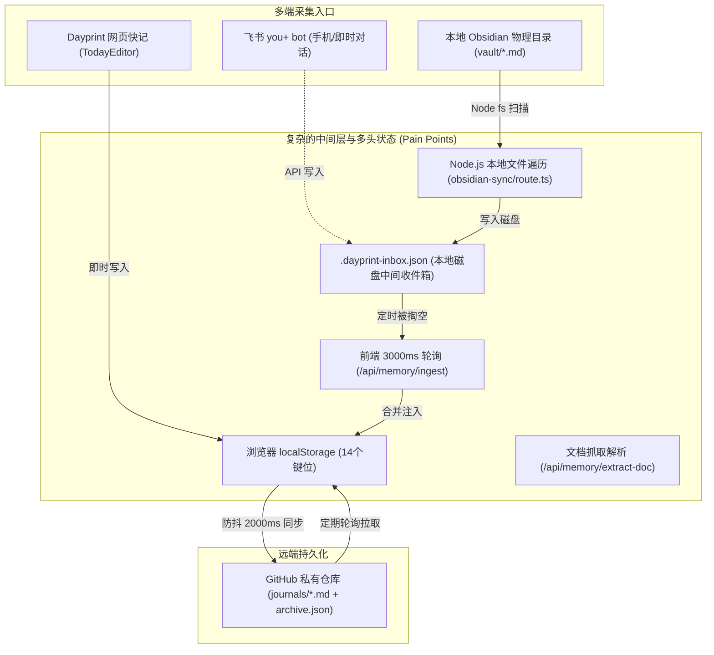
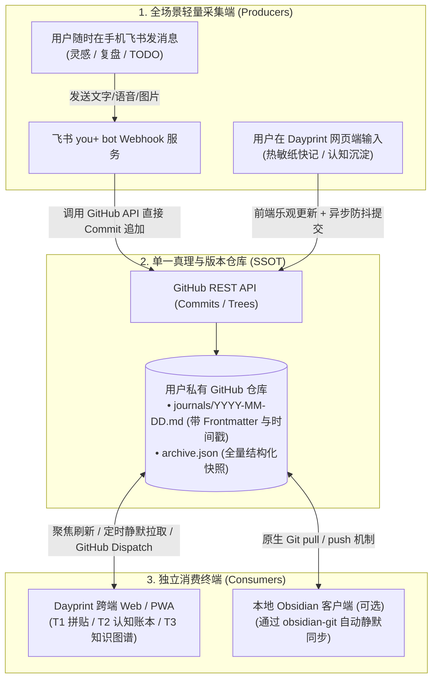
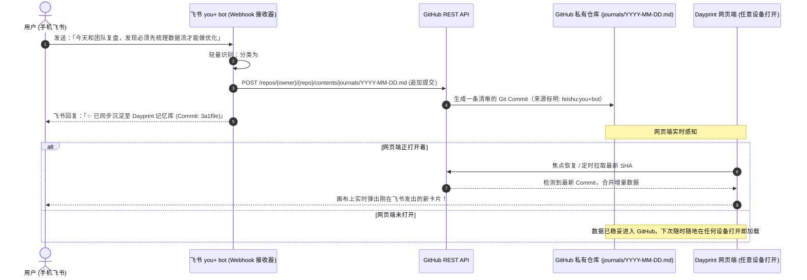

# Dayprint 数据流极简重构方案：剥离本地 Obsidian，确立 GitHub 为单一真理源 (SSOT)

> **核心结论**：你的判断非常敏锐且切中要害。当前系统数据流确实过于杂乱多头。只要将 **GitHub 确立为云端单一真实权威源（Single Source of Truth, SSOT）**，就可以**果断彻底砍掉本地 Obsidian 目录扫描、删除中间收件箱 `.dayprint-inbox.json`、消除前端 3 秒高频轮询**。本地 Obsidian 仅作为下游普通的 Git 仓库查看器，飞书 you+ bot 则作为上游即时采集探针直通 GitHub。

---

## 1. 现状痛点复盘：现有数据流为什么过于复杂？

### 1.1 现状数据流拓扑图 (Current Complex Topology)

### 1.2 现有架构的 4 大硬伤

1. **双重“本地”孤岛，阻断真正跨端 (The Dual-Local Dilemma)**
   - 系统目前有两套完全割裂的“本地”概念：一是**浏览器环境的 `localStorage`**，二是**本机 Node.js 运行时的 `fs` 文件系统（`vault/` 目录）**。
   - 这导致只要把 Dayprint 部署到 Vercel、Cloudflare 或在手机浏览器打开，所有本地 `obsidian-sync` 全部报错瘫痪，严重违背 Web 跨端本质。
2. **中间收件箱 `.dayprint-inbox.json` + 3 秒高频轮询的粗暴设计**
   - 现有的 `/api/memory/ingest` 路由使用了一个名为 `.dayprint-inbox.json` 的磁盘临时文件。
   - 前端通过 `setInterval` 每 3 秒发一次请求“读取并清空”该文件。这种设计不仅浪费 CPU 与 I/O 资源，在多标签页、并发写入或部署到 Serverless 环境时必然发生竞态竞争（Race Condition）导致丢数据。
3. **多头冗余解析器维护成本高**
   - `src/app/api/memory/obsidian-sync/route.ts`（289 行）与 `src/lib/vault-parser.ts`（166 行）存在大量几乎一模一样的正则解析代码（解析 `###` 章节、`- [ ]` 待办、`01_Persona` 加粗特征等）。
4. **飞书 you+ bot 体验被链路割裂**
   - 用户在飞书与 `you+ bot` 对话记录灵感，数据先写到本地中间收件箱，等网页端轮询捞起，再由网页端推到 GitHub——如果电脑睡眠或网页没开，数据就卡在半路。

---

## 2. 重构核心思想：确立 GitHub 为单一真理源 (SSOT)

> **解题刀法**：
> **删除多头中间层，让 GitHub 成为系统的唯一心脏。**
> - **输入端**：Dayprint 网页 + 飞书 you+ bot，均作为**生产者 (Producers)** 直连 GitHub。
> - **状态源**：GitHub 仓库既是云端数据库，又是标准 Markdown Vault。
> - **下游消费**：Dayprint Web 负责富交互呈现；如果用户想用本地 Obsidian，直接用本地 Obsidian 的 **Git 插件**拉取 GitHub 即可，Dayprint 核心代码**完全无需关心、也无需维护任何本地 Obsidian 文件读写逻辑**！

---

## 3. 极简重构后的全新工作流程 (Optimized Streamlined Flow)

### 3.1 优化后的极简数据流架构图

### 3.2 飞书 you+ bot 实时直通链路

不再经过任何本地临时中转，流程直接穿透：

---

## 4. 彻底剥离本地 Obsidian 后的收益对比

| 维度 | 现有架构 (复杂多头) | 优化后架构 (GitHub SSOT) | 收益评估 |
| :--- | :--- | :--- | :--- |
| **架构角色定位** | 试图在浏览器和本地磁盘之间做文件桥接，两头不讨好 | Dayprint 做纯粹的 Web 认知中枢；GitHub 做唯一真理底座；Obsidian 做下游普通只读/只写 Git 客户端 | **职责极度清晰** |
| **云端部署能力** | 严重依赖本机 `fs.readdir` 与 `vault/`，部署到 Vercel 抛 404 | 100% 纯标准 Web API，可一键部署至 Vercel / Cloudflare，手机平板随时可用 | **真正全平台可用** |
| **数据一致性** | 存在本地文件、`.dayprint-inbox.json`、localStorage、GitHub 四处数据，易脏读 | 只有 GitHub 唯一样本，双向并集去重合并 | **彻底杜绝数据漂移** |
| **轮询开销** | 每 3 秒执行一次磁盘 I/O 轮询 (`checkIngestInbox`) | 移除 3 秒轮询；改用 Window Focus（切回标签页）与平缓的心跳同步 | **节省 90% 前端开销** |
| **代码量与维护负担** | 维护近 500 行的本地文件遍历与重复的 Markdown 正则解析 | 削减 450+ 行冗余代码，无磁盘文件读写权限包袱 | **代码极致精简** |

---

## 5. 极简减法落地实施清单 (Ponytail Senior Dev Action Plan)

遵循 **“Deletion over addition”（删除优于增加，最少文件胜出）** 原则：

### 第一步：果断删除冗余文件与端点 (Delete)
- ❌ **删除** `.dayprint-inbox.json`（彻底摒弃本地临时文件）。
- ❌ **删除** `src/app/api/memory/obsidian-sync/route.ts`（移除 289 行本地 Node 文件遍历代码）。
- ❌ **清理** `src/lib/memory-context.tsx` 中的 3 秒轮询：
  - 移除 `const inboxInterval = setInterval(checkIngestInbox, 3000);`。
  - 移除 `checkIngestInbox` 函数及内部逻辑。
- ❌ **精简** `MemoryOSView.tsx`：
  - 移除顶部“一键同步 Obsidian”按钮及 `isSyncingObsidian` 本地扫描逻辑。

### 第二步：强化 GitHub 云端核心读写 (Refactor)
- 保持 `src/app/api/github/sync/route.ts` 作为核心同步通道。
- 保证同步推送到 GitHub 的格式依然是标准的 `journals/YYYY-MM-DD.md`（带 YAML Frontmatter）。
  - *说明*：只要 GitHub 上的文件保持此格式，用户电脑上的 Obsidian 只要开了 `obsidian-git`，本地就依然能完全享受所有内容，Dayprint 却不需要写一行本地 Obsidian 适配代码！

### 第三步：打通飞书 you+ bot 直写 GitHub (Connect)
- 飞书 Webhook 接收到用户消息后，通过 Octokit / Fetch 直接调用 GitHub API 向目标仓库的 `journals/YYYY-MM-DD.md` 追加内容，实现全天候移动端瞬时采集。

---

> **总结**：
> 这一步优化是 Dayprint 从“开发期拼装原型”迈向“成熟纯粹产品”的分水岭。
> 扔掉本地 Node `fs` 的包袱，把本地 Obsidian 降级为外部下游普通工具，以 **GitHub 为真理源、飞书 you+ bot 为采集端、Dayprint 为认知中枢**，整套系统立刻清爽、健壮且真正具备多端生命力。
