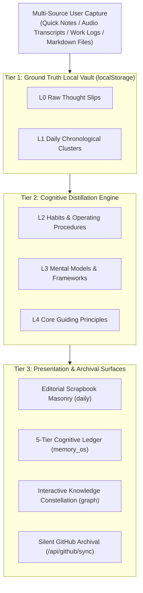

# Dayprint NextGen — Architecture & Product Specification (Extended PRD)

**Product Name:** Dayprint NextGen (Living Memory Sanctuary & Personal Cognitive Archive)  
**Document Version:** v3.2 (Status-Aware Cognitive & Dynamic Knowledge Edition)  
**Date:** October 2026  
**Core Definition:** A Local-First, sovereign personal memory workspace merging tactile physical scrapbook aesthetics with an evolving cognitive knowledge graph.  
**Visual & Tactile Standards:** Morandi Mineral Palette × Editorial Scrapbook Masonry × Swiss International Typography × 4 Physical Paper Textures × Programmatic Mechanical Keystroke Audio.

---

## 1. Product Vision & Philosophy

### 1.1 Vision Statement
> **"Your life, in prints. Frictionless capture, living editorial scrapbook, and silent lifelong sovereignty."**

Dayprint NextGen is a **Living Memory Workspace** designed for knowledge workers, independent creators, and lifelong learners.

It fundamentally reimagines daily journaling and personal knowledge management:
1. **Eliminating the "Write-and-Forget" Digital Wasteland**: Rather than allowing quick thoughts to vanish into disused folders, Dayprint weaves daily slips into weekly digests, thermal receipt stubs, and knowledge constellations.
2. **Transforming Daily Notes into Cognitive Capital**: Powered by an autonomous **L0–L4 Cognitive Evolution Pipeline**, raw observations naturally distill into habits, mental models, and personal north-star principles.
3. **Cross-Day Living Evolution**: Through an integrated `timeline_logs` architecture, related reflections over weeks and months naturally merge into living chronological trees, showing how insights mature over time.

### 1.2 Core Design Principles
1. **Canvas-First Dashboard**: The home surface is an open, coherent workspace. No deep nesting or maze-like navigation; capture, reflection, filtering, and topological resonance flow across a single continuous canvas.
2. **Present at the Center, History in Receipts**: Immediate thoughts take center stage in the capture workbench; historical reflections condense into collectible thermal paper stubs and graph clusters.
3. **Local-First & Absolute Data Sovereignty**: All data lives primarily in the user's browser local storage and plain Markdown files. Fully operational offline, with background debounced commits to the user's private GitHub repository.
4. **Tactile Warmth & Editorial Craft**: Replaces sterile enterprise software UI with warm Morandi tones, washi-tape accents, jagged serrated edges, and authentic mechanical typewriter keystroke audio.

---

## 2. End-to-End System Architecture

---

## 3. Five-Tier Cognitive Hierarchy (L0–L4)

1. **L0 (Ephemeral Stream)**: Raw, immediate micro-impressions captured with zero formatting friction (under 500 characters).
2. **L1 (Daily Digest)**: Automatic chronological clustering per calendar day, grouping related work notes and reflections.
3. **L2 (Habits & SOPs)**: Repeated behavioral patterns, practical operating workflows, and validated lessons learned.
4. **L3 (Mental Models)**: Cross-domain thinking frameworks, strategic concepts, and cognitive models.
5. **L4 (Values & North Star)**: Foundational life philosophies, core identity anchors, and personal guiding convictions.

---

## 4. Local-First & GitHub Silent Sync Specification

- **Primary Source of Truth**: Browser `localStorage` via reactive `MemoryContext` ensures instantaneous, zero-latency rendering.
- **Debounced Background Sync**: State mutations queue a 2000ms debounce timer before dispatching to `/api/github/sync`.
- **Conflict-Free Commit Engine**: Checks remote file SHA, executes a two-way union merge of slips by unique `id`, and pushes `archive.json` plus dated Markdown files (`journals/YYYY-MM-DD.md`).
- **Unload Safeguards**: In-flight synchronization is protected against abrupt tab closure via `window.beforeunload` with `fetch(..., { keepalive: true })` and `navigator.sendBeacon`.
