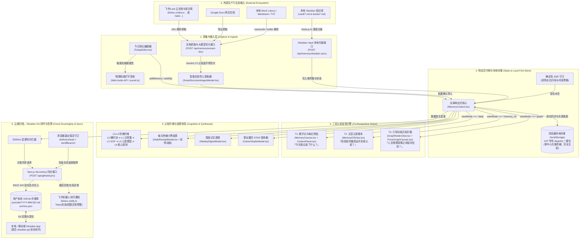
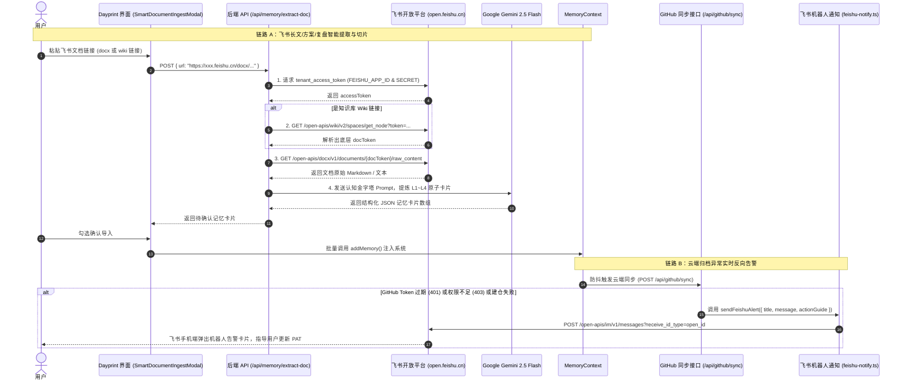
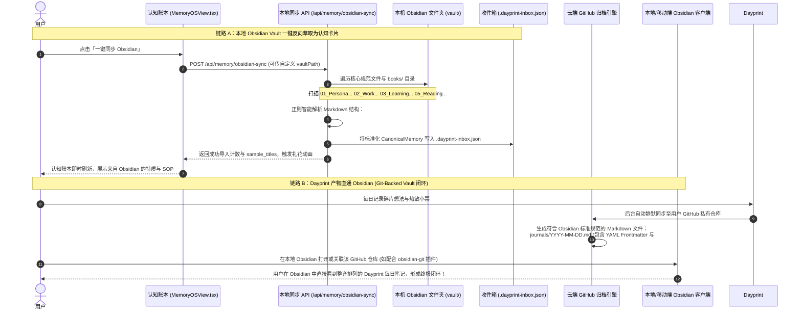

# Dayprint 端到端系统打通架构与全链路实现全景 (System Integration Architecture)

> **文档定位**：本文档为 Dayprint 项目的**单一权威端到端打通规范与全链路架构实现指南**。它完整覆盖了：
> 1. 用户前端微录入与拟物触感反馈
> 2. 本地优先（Local-First）响应式状态中枢与 14 个存储键位
> 3. 三层视角呈现引擎（T1 每日拼贴、T2 认知账本、T3 知识拓扑）
> 4. 认知升维与仪式感结算体系（L0~L4 金字塔、每日热敏小票、周度透镜、STAR 职业资产）
> 5. **飞书（Feishu / Lark）生态全流程打通（文档抓取切片 + 开放平台机器人异常告警）**
> 6. **Obsidian 本地与云端知识库双向打通（Vault 本地扫描解析 + Git-Backed Vault 闭环 + 暗黑主题与力导向图谱对齐）**
> 7. GitHub 云端静默归档、两路防冲突合并与浏览器关闭保活机制

---

## 1. 为什么需要这份整体打通文档？

Dayprint 不仅是一个单机记录网页，而是一个**以数据主权为内核、连接个人私域笔记生态（Obsidian、飞书、GitHub）的数字生命与第二大脑**。
此前仓库中存在若干分散的规范与说明文档（如早期的 `spec.md` 包含部分原型阶段路径，`docs/HANDOFF.md` 较为简短）。为了让开发者、AI 协作 Agent 与进阶用户彻底看清整个系统内数据如何穿透流转，本文档以当前真实的 `src/` 生产代码为基准，将全链路细节彻底打通。

---

## 2. 端到端系统全景架构图 (End-to-End Architecture)



---

## 3. 核心数据流生命周期打通 (Data Lifecycle & Flow)

### 3.1 记录产生与本地写入 (From Keystroke to Storage)
1. **用户输入**：用户在 [TodayEditor.tsx](file:///Users/katherine/Desktop/play&fun/build-with-AI-basics/src/components/canvas/TodayEditor.tsx) 中录入碎片想法，可选设定莫兰迪心绪色彩或附加图片。
2. **拟物触感反馈**：调用 [sound.ts](file:///Users/katherine/Desktop/play&fun/build-with-AI-basics/src/lib/sound.ts) 中的 Web Audio API 原生振荡器与白噪声发生器，零外部音频资源即时生成物理机械按键点击音与纸张撕扯音。
3. **响应式派发**：调用 `MemoryContext.addMemory()`：
   - 生成符合 `CanonicalMemory` 规范的实体，赋予全局唯一 UUID。
   - 采用乐观更新机制立即写入 React 内存状态，用户界面 0 延迟呈现。
   - 序列化写入本地 `localStorage["dayprint_memories"]`。

### 3.2 三维视角数据投影 (Multi-View Projections)
同一底层 `CanonicalMemory[]` 数据在三个互不干扰的视图中映射展现：
- **T1: 每日拼贴 (`viewMode === 'daily'`)**：
  - 核心组件：[MemoryCanvas.tsx](file:///Users/katherine/Desktop/play&fun/build-with-AI-basics/src/components/canvas/MemoryCanvas.tsx) + [ContextPanel.tsx](file:///Users/katherine/Desktop/play&fun/build-with-AI-basics/src/components/navigation/ContextPanel.tsx)。
  - 展示：以时间流与瀑布流形式组织，卡片采用和纸（Washi Paper）质感，右侧折叠面板展示今日沉淀与快捷统计。
- **T2: 认知账本 (`viewMode === 'memory_os'`)**：
  - 核心组件：[MemoryOSView.tsx](file:///Users/katherine/Desktop/play&fun/build-with-AI-basics/src/components/memory-os/MemoryOSView.tsx)。
  - 展示：按照 L0（瞬时碎片）至 L4（底层原则）五级阶梯排布，支持关联验证次数、反思记录 (`timeline_logs`) 的增量回溯与 Obsidian 本地笔记的同步注入。
- **T3: 知识拓扑图 (`viewMode === 'graph'`)**：
  - 核心组件：[GraphNodesView.tsx](file:///Users/katherine/Desktop/play&fun/build-with-AI-basics/src/components/graph/GraphNodesView.tsx) + [ForceGraphCanvas.tsx](file:///Users/katherine/Desktop/play&fun/build-with-AI-basics/src/components/graph/ForceGraphCanvas.tsx)。
  - 展示：基于 HTML5 Canvas 与物理力导向算法，将记忆节点与 `relationships`（支持启发、衍生、矛盾等关系类型）进行星系力学仿真，缩放算法对标 Obsidian Graph View。

### 3.3 认知结晶与仪式感 (Distillation & Receipts)
- **每日热敏小票 ([DailyReceiptModal.tsx](file:///Users/katherine/Desktop/play&fun/build-with-AI-basics/src/components/receipts/DailyReceiptModal.tsx))**：
  一键生成今日消费级热敏小票摘要，包含每日心情指数、核心打卡条目、字数统计与锯齿撕纸边框，触发 `canvas-confetti` 庆祝彩带。
- **周度记忆透镜 ([WeeklyDigestModal.tsx](file:///Users/katherine/Desktop/play&fun/build-with-AI-basics/src/components/digest/WeeklyDigestModal.tsx))**：
  按自然周自动聚合关键认知、情绪主调和行动里程碑，支持就地编辑与 Markdown 导出。
- **职业资产工坊 ([CareerStudioModal.tsx](file:///Users/katherine/Desktop/play&fun/build-with-AI-basics/src/components/career/CareerStudioModal.tsx))**：
  将零散的工作记录通过 STAR（Situation, Task, Action, Result）方法论提取为高价值职业资产。

---

## 4. 外部知识生态全链路打通 (Ecosystem: Feishu & Obsidian)

Dayprint 构建了对两大主流个人与团队知识库——**飞书 (Feishu/Lark)** 与 **Obsidian** 的全流程无缝双向打通。

### 4.1 飞书 (Feishu / Lark) 全链路打通

飞书与 Dayprint 的打通包含**「文档内容逆向提取」**与**「系统告警实时反向推送」**双向闭环：



#### 关键实现细节与配置：
1. **文档提取接口实现**：位于 [src/app/api/memory/extract-doc/route.ts](file:///Users/katherine/Desktop/play&fun/build-with-AI-basics/src/app/api/memory/extract-doc/route.ts)。
   - 自动适配两种格式：文档标准链接 `/docx/([a-zA-Z0-9]+)` 与企业知识库链接 `/wiki/([a-zA-Z0-9]+)`。
   - 若遇到企业内网限制或私有权限文档，接口智能捕获并返回友好指引：`"无法直接读取该飞书文档。请确保飞书应用已开通权限，或直接复制全文粘贴至文本框！"`。
2. **飞书机器人实时通知**：位于 [src/lib/feishu-notify.ts](file:///Users/katherine/Desktop/play&fun/build-with-AI-basics/src/lib/feishu-notify.ts)。
   - 当 GitHub 同步遭遇 Token 失效、403 无写入权限、私有仓库自动创建失败时，无需用户盯着控制台报错，系统自动推送到管理员的飞书会话窗口中。
3. **环境密钥配置 (`.env.local`)**：
   ```env
   FEISHU_APP_ID=cli_xxxxxxxxxxxx
   FEISHU_APP_SECRET=xxxxxxxxxxxxxxxxxxxxxxxx
   FEISHU_ADMIN_OPEN_ID=ou_xxxxxxxxxxxxxxxxxxxxxxxx
   ```

---

### 4.2 Obsidian 本地知识库双向全流程打通

Obsidian 与 Dayprint 的打通实现了**「本地 Vault 深度文件扫描与认知抽取」**与**「GitHub 仓库直通 Obsidian Vault」**的无缝协同：



#### 关键实现细节与规范：
1. **本地 Vault 扫描解析器**：位于 [src/app/api/memory/obsidian-sync/route.ts](file:///Users/katherine/Desktop/play&fun/build-with-AI-basics/src/app/api/memory/obsidian-sync/route.ts) 与共享解析模块 [src/lib/vault-parser.ts](file:///Users/katherine/Desktop/play&fun/build-with-AI-basics/src/lib/vault-parser.ts)。
   - 支持自定义本地目录（通过环境变量 `OBSIDIAN_VAULT_DIR` 或请求体指定，默认读取当前工程根目录下的 `vault/`）。
   - **自动分类映射逻辑**：
     | Obsidian 原始文件 | 识别规则 | 转化为 Dayprint 实体 | 归属认知层级 |
     |---|---|---|---|
     | `01_Persona_and_Values.md` | `traitBullet` / `plainBullet` | 人设与认知模式卡片 | **L4 底层信念** |
     | `02_Work_and_Projects.md` | `### ` 标题、架构/流程/SOP 关键词 | 项目总结与标准化流程 | **L2 SOP / L1 事实** |
     | `03_Learning_and_Skills.md` | `### ` 标题、框架/Benchmark 关键词 | 技能体系与学习模型 | **L2 技能 / L3 心智模型** |
     | `04_Preferences_and_Habits.md`| `- [ ]` 习惯项与偏好列表 | 个人生活与工作偏好 | **L2 习惯** |
     | `05_Reading_Notes.md` & `books/*.md`| `- [YYYY-MM-DD] 《书名》` | 读书摘录与深度反思 | **L1 读书洞见** |
2. **Git-Backed Vault 零成本打通**：
   - Dayprint 在 GitHub 同步时生成的 `journals/YYYY-MM-DD.md` 采用了纯正的 Markdown + YAML Frontmatter 格式，完全遵循 Obsidian 官方文档规范。
   - 用户只需在本地 Obsidian 中执行 `git clone <Dayprint-storage>` 或安装社区广受欢迎的 **Obsidian Git** 插件，本地与网页端的日记便实现毫秒级自动拉取与合并。
3. **视觉与交互深度对齐**：
   - **暗黑主题**：系统内置 `obsidian-dark` 专属主题（在 [src/app/globals.css](file:///Users/katherine/Desktop/play&fun/build-with-AI-basics/src/app/globals.css) 中以 `[data-theme="obsidian-dark"]` 精确复刻 Obsidian 官方经典的黑曜石灰阶与高对比度文字）。
   - **拓扑图谱**：力导向图谱 [ForceGraphCanvas.tsx](file:///Users/katherine/Desktop/play&fun/build-with-AI-basics/src/components/graph/ForceGraphCanvas.tsx) 实现了跟随鼠标滚轮的光标原点缩放、远距离缩放为微小圆点阵列（Minimal Dot Mode）等特性，交互体验 100% 对齐 Obsidian Graph View。

---

## 5. 关键数据结构打通标准 (Canonical Schemas)

定义位置：[src/types/memory.ts](file:///Users/katherine/Desktop/play&fun/build-with-AI-basics/src/types/memory.ts)

### 5.1 核心记忆实体 (`CanonicalMemory`)
```typescript
export interface CanonicalMemory {
  id: string;                    // 全局唯一 UUID (如 "mem-1729837200000-abcd")
  text: string;                  // 记忆主体文本 (支持 Markdown / 富文本)
  category: Category;            // 领域类别: "Insight" | "Mood" | "Work" | "Life"
  level: MemoryLevel;            // 认知层级: 0 (L0) 到 4 (L4)
  created_at: string;            // ISO 8601 创建时间戳
  updated_at: string;            // ISO 8601 更新时间戳
  image_url?: string;            // 附件图片 (Base64 或持久化链接)
  pinned?: boolean;              // 是否置顶
  mood?: MoodType;               // 心情色彩标记
  timeline_logs?: TimelineLog[]; // 生长时间轴: 记录后续反思、进化批注
  metadata?: {
    tags?: string[];             // 自由标签 (兼容 Obsidian #标签)
    source?: string;             // 录入来源: "manual" | "file-ingest" | "you+obsidian" | "feishu"
    star_breakdown?: StarModel;  // 绑定的 STAR 结构
    custom_position?: { x: number; y: number }; // 画布自定义坐标
  };
}
```

### 5.2 认知关系实体 (`MemoryRelationship`)
```typescript
export interface MemoryRelationship {
  id: string;                    // 关系唯一标识
  source_id: string;             // 源记忆 ID
  target_id: string;             // 目标记忆 ID
  type: RelationType;            // 关系类型: "inspires" | "supports" | "contradicts" | "evolves_into"
  strength: number;              // 连接权重 (0.0 ~ 1.0)
  annotation?: string;           // 关系描述与背后的逻辑
}
```

### 5.3 浏览器存储映射表 (14 Dedicated `dayprint_*` Keys)
| Key 名称 | 存储内容 | 作用与生命周期 |
|---|---|---|
| `dayprint_memories` | `CanonicalMemory[]` | 系统核心资产，所有记忆切片的总存储 |
| `dayprint_relationships` | `MemoryRelationship[]` | 记忆节点间的拓扑关系边集合 |
| `dayprint_receipts` | `Record<string, DailyReceipt>` | 历日热敏小票的历史存档快照 |
| `dayprint_settings` | `AppSettings` | 用户配置（语言、主题、GitHub 仓库与 PAT） |
| `dayprint_custom_positions`| 节点位置字典 | 空间画布与图谱中的用户手动拖拽坐标 |
| `dayprint_onboarding_completed`| 布尔标记 | 欢迎指引浮窗是否已完成 |
| `dayprint_vault_index` | 目录缓存索引 | 智能文档与本地 Vault 导入的元数据索引 |

---

## 6. 项目源码核心映射表 (Source Code Mapping)

当前代码库已完全结构化，关键业务组件与路径映射如下：

```
src/
├── app/
│   ├── page.tsx                     # 应用主入口，调度导航、主视口与全局 Modal
│   ├── layout.tsx                   # 根布局与元数据注入
│   ├── globals.css                  # 全局样式、纸张纹理与 obsidian-dark 主题规则
│   └── api/
│       ├── github/sync/route.ts     # GitHub 云端双向同步、防冲突与飞书异常告警触发
│       ├── memory/
│       │   ├── extract-doc/route.ts # 【飞书/Google Docs/Word/TXT】抓取与 Gemini 认知切片
│       │   └── obsidian-sync/route.ts # 【Obsidian】本地 Vault 目录结构化解析与收件箱导入
│       └── translate/               # 多语言辅助翻译接口
├── components/
│   ├── canvas/                      # 【T1 每日拼贴视口】
│   │   ├── MemoryCanvas.tsx         # 核心时间线/瀑布流主画布
│   │   ├── MemoryCard.tsx           # 和纸质感记忆卡片 (支持 obsidian-dark 主题切换)
│   │   ├── TodayEditor.tsx          # 底部常驻微录入停靠栏 (带飞书/长文提取入口)
│   │   ├── SmartDocumentIngestModal.tsx # 【外部生态导入弹窗】支持飞书链接、文件上传与样例导入
│   │   └── ConnectionModal.tsx      # 节点关联连接建立浮窗
│   ├── memory-os/                   # 【T2 认知账本视口】
│   │   └── MemoryOSView.tsx         # L0-L4 阶梯矩阵、STAR 工作台与「一键同步 Obsidian」
│   ├── graph/                       # 【T3 知识拓扑视口】
│   │   ├── GraphNodesView.tsx       # 拓扑图容器与交互控制栏
│   │   └── ForceGraphCanvas.tsx     # Canvas 物理力导向图谱渲染器 (对标 Obsidian Graph View)
│   ├── navigation/                  # 【全局导航与控制】
│   │   ├── HeaderBar.tsx            # 顶部操作栏 (视图切换、快速搜索、同步指示器)
│   │   ├── AppSidebar.tsx           # 左侧全局功能抽屉导航 (主题切换：纸张 / 黑曜石暗黑 / 极简白)
│   │   ├── ContextPanel.tsx         # 右侧今日统计与时光轴折叠辅助面板
│   │   ├── GitHubSettingsModal.tsx  # GitHub PAT 与同步策略配置弹窗
│   │   └── WelcomeGatewayModal.tsx  # 首次使用引导欢迎网关
│   ├── receipts/                    # 【热敏小票与仪式感】
│   │   └── DailyReceiptModal.tsx    # 每日小票核算、盖印与彩带结课弹窗
│   ├── digest/                      # 【周度记忆透镜】
│   │   └── WeeklyDigestModal.tsx    # 自然周认知合成与 Markdown 导出
│   └── career/                      # 【职业成长工坊】
│       └── CareerStudioModal.tsx    # STAR 经历提炼与履历资产库
└── lib/                             # 【底层通用设施】
    ├── memory-context.tsx           # 全局状态管理中枢 (内存 + 本地存储 + 云端派发)
    ├── feishu-notify.ts             # 【飞书通知核心】开放平台机器人消息与告警卡片发送
    ├── vault-parser.ts              # 【Obsidian 解析核心】多格式 Markdown 认知提取公共方法
    ├── github-repo.ts               # GitHub REST API 交互封装与防冲突合并
    ├── sound.ts                     # Web Audio API 物理打字音效合成器
    ├── moods.ts                     # 莫兰迪色系与情绪状态映射
    └── date.ts                      # 确定性防 SSR 闪烁的日期时间工具集
```

---

## 7. 全流程端到端运行与打通验证清单 (Run & Verification)

### 7.1 启动本地开发服务
```bash
# 1. 安装依赖 (推荐 pnpm)
pnpm install

# 2. 启动 Next.js 极速开发环境
pnpm dev
```
打开浏览器访问 [http://localhost:3000](http://localhost:3000)。

### 7.2 整体打通验证矩阵
| 验证环节 | 验证操作与预期结果 | 涉及核心文件与接口 |
|---|---|---|
| **1. 随手记与音效** | 在底部 `TodayEditor` 录入文字，按下回车。听到物理按键音，和纸卡片立即以动画形式展现在 T1 画布上。 | `TodayEditor.tsx` / `sound.ts` / `MemoryContext.tsx` |
| **2. 飞书文档导入打通** | 点击录入栏的文档导入图标，选择“飞书复盘”样例或填入飞书公开文档链接，点击“提取认知卡片”。系统通过飞书 OpenAPI 抓取正文并由 Gemini 提炼出 2~6 张认知金字塔卡片。 | `SmartDocumentIngestModal.tsx` / `/api/memory/extract-doc` |
| **3. Obsidian 本地同步打通** | 点击顶部“T2 认知账本”，点击右上角“一键同步 Obsidian”。系统扫描本地 `vault/` 下的 Markdown 文件并注入记忆账本，弹出成功气泡并喷射彩带。 | `MemoryOSView.tsx` / `/api/memory/obsidian-sync` |
| **4. Obsidian 格式云端闭环** | 配置 GitHub 仓库并点击“立即同步”。进入 GitHub 私有仓库，查看生成的 `journals/YYYY-MM-DD.md`，使用本地 Obsidian 打开该目录，验证日记可直接无缝浏览与双链跳转。 | `/api/github/sync` / `journals/*.md` |
| **5. 飞书机器人告警打通** | 在设置中故意填写错误的 GitHub PAT 并触发同步。系统在前端展示错误的同时，通过飞书机器人向配置的 `FEISHU_ADMIN_OPEN_ID` 推送格式化的排障预警卡片。 | `feishu-notify.ts` / `/api/github/sync` |
| **6. 热敏小票与仪式感** | 点击侧边栏或右侧面板的“每日小票”，触发纸张锯齿渲染与结算彩带喷射。 | `DailyReceiptModal.tsx` / `canvas-confetti` |
| **7. 个人记忆引擎与 MCP 打通** | 统一采集端点 `/api/v1/capture` 自动落库 GitHub `inbox/` 原子存证与 Neon/本地状态机，提取候选记忆并通过「记忆审核治理中心」进行 ADD/MERGE/SUPERSEDE 审核，同时支持外部 Agent 通过标准 `/api/v1/mcp` 协议安全检索记忆。 | `src/lib/memory-engine/` / `ReviewCenterModal.tsx` / `/api/v1/mcp` |

---

## 8. 个人记忆引擎与 MCP 架构实现 (Personal Memory Engine v1.0)

根据 `prd-chatgpt.md` 的规范，Dayprint 已完成云端事件驱动与记忆治理引擎升级：

1. **统一采集网关 (`/api/v1/capture`)**：
   - 接收来自 Web 前端、飞书机器人、外部 Agent（nanoMuse、Claude Code 等）的原始输入；
   - 强制 SHA-256 内容哈希防重校验与幂等性保障；
   - 原子不可变存档：将原始事件以单文件形式追加写入用户私有 GitHub 仓库 `inbox/YYYY/MM/DD/event_<id>.json`。
2. **Neon PostgreSQL 数据库与双模自适应存储 (`src/lib/memory-engine/store.ts`)**：
   - 提供了包含 `events`, `memory_candidates`, `memories`, `memory_history`, `processing_jobs`, `memory_embeddings` 的标准 SQL Schema (`database/schema.sql`)；
   - 支持无感自适应：未配置 Neon `DATABASE_URL` 时自动启用本地高保真轻量存储驱动，配置后自动连接 Neon Postgres。
3. **证据链提取与记忆治理状态机 (`src/lib/memory-engine/governance.ts`)**：
   - **Candidate Before Commitment**：AI 提取的记忆先入候选池（Candidate），带有原文引用（Evidence Quote）与来源 Event ID；
   - **Reconciliation**：仲裁算子（`ADD` / `MERGE` / `UPDATE` / `SUPERSEDE` / `LINK` / `REVIEW` / `REJECT`）；
   - **历史不可变审计**：记忆更新或更迭时，旧记录保留在 `memory_history` 审计链中并标记 `valid_until`，绝不直接物理覆写。
4. **标准 MCP Server 协议 (`/api/v1/mcp`)**：
   - 开放 `search_memory`, `get_memory`, `get_profile`, `save_memory`, `create_journal` 等标准工具，允许外部自主 Agent 接入长短期记忆。
5. **记忆审核治理中心 (`ReviewCenterModal.tsx`)**：
   - 用户在界面可实时查看待审候选条目、证据链溯源、AI 判定理由与操作建议，并一键核准（Approve）或拒绝（Reject）。

---

> **维护约定**：任何涉及生态接口变更、字段增补或存储逻辑的调整，必须同时维护更新本全景文档，确保代码与设计 100% 同步交付。
