# Dayprint 端到端系统打通架构与全链路实现全景 (System Integration Architecture)

> **文档定位**：本文档为 Dayprint 项目的**单一权威端到端打通规范与全链路架构实现指南**。它串联了用户端交互、核心数据模型、三层视图呈现、认知升维流水线、本地优先存储（Local-First）以及 GitHub 静默云端归档与告警机制。

---

## 1. 为什么需要这份整体打通文档？

在此之前，仓库中存在若干分散的规范与说明文档（如早期的 `spec.md` 包含部分原型阶段路径，`docs/HANDOFF.md` 较为简短，`docs/PRD-Dayprint-NextGen.md` 侧重产品功能定义）。
随着 Dayprint 演进为成熟的 **NextGen 个人认知栖息地与第二大脑**，系统形成了完整的六大子系统协同闭环。本文档将实际代码实现（100% 对应当前 `src/` 代码库）与底层数据流完整打通，提供清晰的全景图。

---

## 2. 端到端系统打通全景图 (End-to-End Architecture)

```mermaid
flowchart TD
    %% Capture Layer
    subgraph CaptureLayer["1. 采集与输入层 (Capture & Ingest)"]
        TodayEditor["今日快记编辑器\n(TodayEditor.tsx)"]
        AudioSynthesizer["物理机械打字音效\n(Web Audio API / sound.ts)"]
        DocIngest["智能文档解析器\n(Word / Markdown / TXT)\n(SmartDocumentIngestModal.tsx)"]
        MoodSelector["五色莫兰迪心绪选择器\n(moods.ts)"]
        TodayEditor -->|触发机械按键音| AudioSynthesizer
        TodayEditor -->|选择心绪/附图| MoodSelector
    end

    %% State & Storage Layer
    subgraph StateLayer["2. 响应式中枢与本地存储 (State & Local-First Store)"]
        MemoryCtx["全局响应式核心\n(MemoryContext.tsx)"]
        LocalStorage[("浏览器本地存储 (localStorage)\n14个专有 dayprint_* 键位\n(零中心化服务器，完全主权)")]
        SSRGuard["确定性 SSR 守卫\n(消除水合闪烁与时间漂移)"]
        
        TodayEditor -->|addMemory / addSlip| MemoryCtx
        DocIngest -->|批量注入 CanonicalMemory| MemoryCtx
        MemoryCtx <-->|双向同步与乐观更新| LocalStorage
        SSRGuard -->|安全水合| MemoryCtx
    end

    %% Presentation Layer
    subgraph ViewLayer["3. 三层认知呈现引擎 (Tri-Perspective Views)"]
        T1["T1: 随手记与每日拼贴\n(MemoryCanvas.tsx + ContextPanel.tsx)\n「今天我记录了什么？」"]
        T2["T2: 五层认知账本\n(MemoryOSView.tsx)\n「经验如何被验证并形成认知？」"]
        T3["T3: 力导向知识拓扑图\n(GraphNodesView.tsx + ForceGraphCanvas.tsx)\n「人生物理洞察之间如何交织？」"]
        
        MemoryCtx -->|viewMode === 'daily'| T1
        MemoryCtx -->|viewMode === 'memory_os'| T2
        MemoryCtx -->|viewMode === 'graph'| T3
    end

    %% Distillation & Syntheses Layer
    subgraph CognitiveLayer["4. 认知升维与结算体系 (Cognitive & Syntheses)"]
        CognitivePipeline["L0-L4 阶梯升维\nL0 瞬时流 ➔ L1 日常簇 ➔ L2 SOP ➔ L3 心智模型 ➔ L4 核心原则"]
        DailyReceipt["每日热敏小票结算\n(DailyReceiptModal.tsx + 彩带动画)"]
        WeeklyDigest["周度记忆透镜\n(WeeklyDigestModal.tsx)"]
        CareerStudio["职业履历 STAR 提炼器\n(CareerStudioModal.tsx)"]
        
        MemoryCtx --> CognitivePipeline
        MemoryCtx --> DailyReceipt
        MemoryCtx --> WeeklyDigest
        MemoryCtx --> CareerStudio
    end

    %% Archival & Safeguards Layer
    subgraph CloudLayer["5. 云端归档与静默主权守护 (Cloud Sovereignty & Sync)"]
        DebounceTimer["2000ms 变更防抖拦截"]
        SyncAPI["Next.js Serverless 同步接口\n(POST /api/github/sync)"]
        GitHubRepo[("用户私有 GitHub 存储库\njournals/YYYY-MM-DD.md\narchive.json")]
        UnloadGuard["浏览器退出保活守卫\n(beforeunload + sendBeacon)"]
        FeishuAlert["飞书机器人实时通知\n(feishu-notify.ts\nToken失效/权限异常预警)"]
        
        MemoryCtx -->|数据发生变更| DebounceTimer
        DebounceTimer -->|分发同步请求| SyncAPI
        UnloadGuard -->|页面关闭逃逸保障| SyncAPI
        SyncAPI -->|REST API 双向合并写入| GitHubRepo
        SyncAPI -.->|鉴权异常/仓库异常| FeishuAlert
    end
```



---

## 3. 核心数据流生命周期打通 (Data Lifecycle & Flow)

### 3.1 记录产生与本地写入 (From Keystroke to Storage)
1. **用户输入**：用户在 [TodayEditor.tsx](file:///Users/katherine/Desktop/play&fun/build-with-AI-basics/src/components/canvas/TodayEditor.tsx) 中录入碎片想法，可选设定莫兰迪心绪色彩或附加图片。
2. **拟物触感反馈**：调用 [sound.ts](file:///Users/katherine/Desktop/play&fun/build-with-AI-basics/src/lib/sound.ts) 中的 Web Audio API 原生振荡器与白噪声发生器，零外部音频资源即时生成物理机械按键点击音与纸张撕扯音。
3. **响应式派发**：调用 `MemoryContext.addMemory()`：
   - 生成符合 `CanonicalMemory` 规范的实体，赋予全局唯一 UUID。
   - 采用乐观更新机制立即写入 React 内存状态，用户界面 0 延迟呈现。
   - 序列化写入本地 `localStorage["dayprint_memories"]`。

### 3.2 三维视角数据投影 (Multi-View Projections)
同一底层 `CanonicalMemory[]` 数据在三个互不干扰的视图中映射展现：
- **T1: 每日拼贴 (`viewMode === 'daily'`)**：
  - 核心组件：[MemoryCanvas.tsx](file:///Users/katherine/Desktop/play&fun/build-with-AI-basics/src/components/canvas/MemoryCanvas.tsx) + [ContextPanel.tsx](file:///Users/katherine/Desktop/play&fun/build-with-AI-basics/src/components/navigation/ContextPanel.tsx)。
  - 展示：以时间流与瀑布流形式组织，卡片采用和纸（Washi Paper）质感，右侧折叠面板展示今日沉淀与快捷统计。
- **T2: 认知账本 (`viewMode === 'memory_os'`)**：
  - 核心组件：[MemoryOSView.tsx](file:///Users/katherine/Desktop/play&fun/build-with-AI-basics/src/components/memory-os/MemoryOSView.tsx)。
  - 展示：按照 L0（瞬时碎片）至 L4（底层原则）五级阶梯排布，支持关联验证次数、反思记录 (`timeline_logs`) 的增量回溯。
- **T3: 知识拓扑图 (`viewMode === 'graph'`)**：
  - 核心组件：[GraphNodesView.tsx](file:///Users/katherine/Desktop/play&fun/build-with-AI-basics/src/components/graph/GraphNodesView.tsx) + [ForceGraphCanvas.tsx](file:///Users/katherine/Desktop/play&fun/build-with-AI-basics/src/components/graph/ForceGraphCanvas.tsx)。
  - 展示：基于 HTML5 Canvas 与物理力导向算法，将记忆节点与 `relationships`（支持启发、衍生、矛盾等关系类型）进行星系力学仿真。

### 3.3 认知结晶与仪式感 (Distillation & Receipts)
- **每日热敏小票 ([DailyReceiptModal.tsx](file:///Users/katherine/Desktop/play&fun/build-with-AI-basics/src/components/receipts/DailyReceiptModal.tsx))**：
  一键生成今日消费级热敏小票摘要，包含每日心情指数、核心打卡条目、字数统计与锯齿撕纸边框，触发 `canvas-confetti` 庆祝彩带。
- **周度记忆透镜 ([WeeklyDigestModal.tsx](file:///Users/katherine/Desktop/play&fun/build-with-AI-basics/src/components/digest/WeeklyDigestModal.tsx))**：
  按自然周自动聚合关键认知、情绪主调和行动里程碑，支持就地编辑与 Markdown 导出。
- **职业资产工坊 ([CareerStudioModal.tsx](file:///Users/katherine/Desktop/play&fun/build-with-AI-basics/src/components/career/CareerStudioModal.tsx))**：
  将零散的工作记录通过 STAR（Situation, Task, Action, Result）方法论提取为高价值职业资产。

### 3.4 GitHub 云端静默归档与容灾链路 (GitHub Sovereign Sync)
1. **防抖排队**：本地状态变化触发 `useEffect`，启动 2000ms 防抖计时器。
2. **轻量请求**：防抖结束后向服务端路由 `POST /api/github/sync` 发送当前全量快照。
3. **两路写入**：
   - `archive.json`：存放机器可读的全量 JSON 数据。
   - `journals/YYYY-MM-DD.md`：自动格式化为极具可读性的 Markdown 文档，每一篇均可直接作为独立静态博客或 Obsidian 笔记使用。
4. **两路合并与防冲突 (Conflict Resolution)**：
   若 GitHub 返回 HTTP 409 冲突，后端自动获取远程文件的最新 SHA，执行基于内存 UUID 的并集双向合并后重新提交。
5. **关页逃逸保障 (Unload Keepalive)**：
   在 `window.beforeunload` 事件中挂载 `fetch(..., { keepalive: true })` 与 `navigator.sendBeacon`，确保用户突然关闭标签页时正在发送的数据不丢失。
6. **飞书通知告警 ([feishu-notify.ts](file:///Users/katherine/Desktop/play&fun/build-with-AI-basics/src/lib/feishu-notify.ts))**：
   当 GitHub PAT 过期（HTTP 401）、仓库权限不足（HTTP 403）或自动建仓失败时，系统自动通过配置的飞书机器人 Webhook 将结构化告警卡片推送到用户手机端。

---

## 4. 关键数据结构打通标准 (Canonical Schemas)

定义位置：[src/types/memory.ts](file:///Users/katherine/Desktop/play&fun/build-with-AI-basics/src/types/memory.ts)

### 4.1 核心记忆实体 (`CanonicalMemory`)
```typescript
export interface CanonicalMemory {
  id: string;                    // 全局唯一 UUID (如 "mem-1729837200000-abcd")
  text: string;                  // 记忆主体文本 (支持 Markdown / 富文本)
  category: Category;            // 领域类别: "Insight" | "Mood" | "Work" | "Life"
  level: MemoryLevel;            // 认知层级: 0 (L0) 到 4 (L4)
  created_at: string;            // ISO 8601 创建时间戳
  updated_at: string;            // ISO 8601 更新时间戳
  image_url?: string;            // 附件图片 (Base64 或持久化链接)
  pinned?: boolean;              // 是否置顶
  mood?: MoodType;               // 心情色彩标记
  timeline_logs?: TimelineLog[]; // 生长时间轴: 记录后续反思、进化批注
  metadata?: {
    tags?: string[];             // 自由标签
    source?: string;             // 录入来源: "manual" | "file-ingest" | "audio"
    star_breakdown?: StarModel;  // 绑定的 STAR 结构
    custom_position?: { x: number; y: number }; // 画布自定义坐标
  };
}
```

### 4.2 认知关系实体 (`MemoryRelationship`)
```typescript
export interface MemoryRelationship {
  id: string;                    // 关系唯一标识
  source_id: string;             // 源记忆 ID
  target_id: string;             // 目标记忆 ID
  type: RelationType;            // 关系类型: "inspires" | "supports" | "contradicts" | "evolves_into"
  strength: number;              // 连接权重 (0.0 ~ 1.0)
  annotation?: string;           // 关系描述与背后的逻辑
}
```

### 4.3 浏览器存储映射表 (14 Dedicated `dayprint_*` Keys)
| Key 名称 | 存储内容 | 作用与生命周期 |
|---|---|---|
| `dayprint_memories` | `CanonicalMemory[]` | 系统核心资产，所有记忆切片的总存储 |
| `dayprint_relationships` | `MemoryRelationship[]` | 记忆节点间的拓扑关系边集合 |
| `dayprint_receipts` | `Record<string, DailyReceipt>` | 历日热敏小票的历史存档快照 |
| `dayprint_settings` | `AppSettings` | 用户配置（语言、主题、GitHub 仓库与 PAT） |
| `dayprint_custom_positions`| 节点位置字典 | 空间画布与图谱中的用户手动拖拽坐标 |
| `dayprint_onboarding_completed`| 布尔标记 | 欢迎指引浮窗是否已完成 |
| `dayprint_vault_index` | 目录缓存索引 | 智能文档导入的元数据索引 |

---

## 5. 项目源码核心映射表 (Source Code Mapping)

当前代码库已完全结构化，关键业务组件与路径映射如下：

```
src/
├── app/
│   ├── page.tsx                     # 应用主入口，调度导航、主视口与全局 Modal
│   ├── layout.tsx                   # 根布局与元数据注入
│   ├── globals.css                  # 全局样式、纸张纹理定义与 Tailwind v4 规则
│   └── api/
│       ├── github/sync/route.ts     # GitHub 云端双向同步与自动建仓 Serverless 端点
│       ├── feishu/notify/           # (可选) 飞书服务端通知接口
│       └── translate/               # 多语言辅助翻译接口
├── components/
│   ├── canvas/                      # 【T1 每日拼贴视口】
│   │   ├── MemoryCanvas.tsx         # 核心时间线/瀑布流主画布
│   │   ├── MemoryCard.tsx           # 和纸质感记忆卡片
│   │   ├── TodayEditor.tsx          # 底部常驻微录入停靠栏
│   │   ├── SmartDocumentIngestModal.tsx # Word/Markdown/TXT 文档智能导入弹窗
│   │   └── ConnectionModal.tsx      # 节点关联连接建立浮窗
│   ├── memory-os/                   # 【T2 认知账本视口】
│   │   └── MemoryOSView.tsx         # L0-L4 阶梯矩阵与认知沉淀工作台
│   ├── graph/                       # 【T3 知识拓扑视口】
│   │   ├── GraphNodesView.tsx       # 拓扑图容器与交互控制栏
│   │   └── ForceGraphCanvas.tsx     # HTML5 Canvas 物理力导向图谱渲染器
│   ├── navigation/                  # 【全局导航与控制】
│   │   ├── HeaderBar.tsx            # 顶部操作栏 (视图切换、快速搜索、同步指示器)
│   │   ├── AppSidebar.tsx           # 左侧全局功能抽屉导航
│   │   ├── ContextPanel.tsx         # 右侧今日统计与时光轴折叠辅助面板
│   │   ├── GitHubSettingsModal.tsx  # GitHub PAT 与同步策略配置弹窗
│   │   └── WelcomeGatewayModal.tsx  # 首次使用引导欢迎网关
│   ├── receipts/                    # 【热敏小票与仪式感】
│   │   └── DailyReceiptModal.tsx    # 每日小票核算、盖印与彩带结课弹窗
│   ├── digest/                      # 【周度记忆透镜】
│   │   └── WeeklyDigestModal.tsx    # 自然周认知合成与 Markdown 导出
│   └── career/                      # 【职业成长工坊】
│       └── CareerStudioModal.tsx    # STAR 经历提炼与履历资产库
└── lib/                             # 【底层通用设施】
    ├── memory-context.tsx           # 全局状态管理中枢 (内存 + 本地存储 + 云端派发)
    ├── github-repo.ts               # GitHub REST API 交互封装与防冲突合并
    ├── feishu-notify.ts             # 飞书机器人 Webhook 智能告警分发
    ├── sound.ts                     # Web Audio API 物理打字音效合成器
    ├── moods.ts                     # 莫兰迪色系与情绪状态映射
    ├── date.ts                      # 确定性防 SSR 闪烁的日期时间工具集
    └── vault-parser.ts              # 本地 Markdown/Frontmatter 导入导出解析器
```

---

## 6. 本地运行与全链路验证 (Run & Verification)

### 6.1 启动本地开发服务
```bash
# 1. 安装依赖 (推荐 pnpm)
pnpm install

# 2. 启动 Next.js 极速热更新开发环境
pnpm dev
```
浏览器打开 [http://localhost:3000](http://localhost:3000)。

### 6.2 全流程打通验证步骤
1. **录入一条即时记忆**：在底部 `TodayEditor` 输入文字并按下回车，倾听是否有打字音效，观察卡片是否以和纸动画注入主画布。
2. **切换三层视图**：点击顶部导航栏中的 `T1 日常`、`T2 认知账本`、`T3 知识拓扑`，确认数据在三层视图间流畅同步。
3. **验证 GitHub 静默同步**：
   - 打开设置弹窗，填入个人 GitHub PAT 及私有仓库名（如 `Dayprint-storage`）。
   - 点击“立即同步”，检查 GitHub 仓库中是否生成了 `archive.json` 及 `journals/YYYY-MM-DD.md`。
4. **生成热敏小票**：点击右侧面板或左侧导航的“每日小票”，体验锯齿小票生成与彩带喷射效果。

---

> **维护约定**：任何新增功能组件、存储字段或架构调整，均须遵循 `ponytail` 极简 Senior 规范，并在交付代码的同时同步更新本打通规范。
