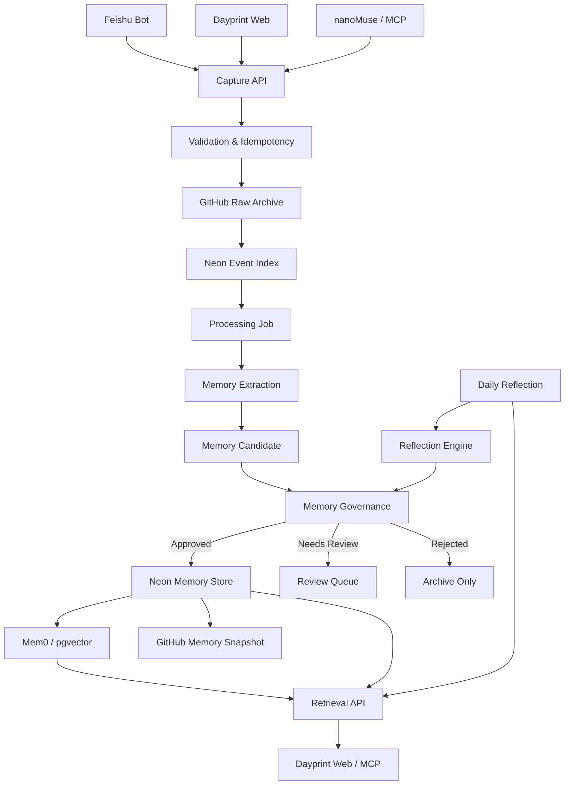

# Dayprint — Memory System Technical PRD

**Version:** 1.0  
**Module:** Personal Memory Engine  
**Priority:** Core Infrastructure  
**Architecture:** Cloud-first · Event-driven · Evidence-based · User-controlled

---

# 1. Product Objective

## 1.1 Vision

Dayprint is a personal memory system that continuously captures, organizes, retrieves, and evolves a user's long-term knowledge, experiences, preferences, and personal context.

It should not simply store conversations or generate summaries.

It should gradually develop a structured, evidence-backed understanding of the user while preserving the original records and allowing the user to inspect, correct, update, and delete memories.

## 1.2 Core Principles

1. **Raw data is immutable:** AI-generated memories must never overwrite original user records.
2. **Evidence before inference:** Every extracted memory must be traceable to its source.
3. **Candidate before commitment:** AI-generated memories must pass governance before becoming active memories.
4. **Temporal awareness:** Changes in preferences, goals, and beliefs must preserve historical versions.
5. **User ownership:** Users retain control over their long-term memories.
6. **Provider independence:** LLMs, embedding models, and memory engines must be replaceable.
7. **Graceful degradation:** AI failures must not cause original data loss.
8. **Minimal infrastructure:** Prefer free-tier cloud services and avoid unnecessary always-on servers.

## 1.3 Non-goals for MVP

- Training a personalized foundation model.
- Building a complete autonomous AI agent.
- Deploying a native temporal graph database.
- Automatically inferring personality or psychological characteristics.
- Automatically rewriting all user memories.
- Running local LLMs or requiring a continuously running personal computer.

---

# 2. System Architecture

## 2.1 Technology Stack

| Component | Technology | Responsibility |
|---|---|---|
| Frontend | Next.js + Vercel | Dayprint Web |
| Capture API | Next.js API Routes | Unified event ingestion |
| Archive | GitHub Private Repository | Durable raw records |
| Database | Neon PostgreSQL | Structured data and job state |
| Vector Search | pgvector | Semantic retrieval |
| Memory Engine | Mem0 OSS | Memory extraction/retrieval primitives |
| LLM | Cloudflare Workers AI | Text generation and reasoning |
| Embeddings | Cloudflare Workers AI | Vector generation |
| Agent Integration | MCP | nanoMuse, Codex, Claude Code |
| Scheduled Processing | GitHub Actions / supported scheduled jobs | Reflection and recovery |

**Important integration requirement:** Do not assume Mem0's TypeScript SDK supports every Cloudflare Workers AI model natively. Build a provider adapter and validate the exact SDK version, model interface, embedding dimensions, and vector-store compatibility through a proof of concept before integrating it into the production pipeline.

The Dayprint application must remain functional if Mem0 is replaced.

## 2.2 Architecture Diagram



## 2.3 Logical Layers

### L0 — Capture Layer
Receives data from all sources.

### L1 — Event and Archive Layer
Stores immutable raw events and metadata.

### L2 — Extraction Layer
Transforms raw content into structured candidate memories.

### L3 — Governance Layer
Handles deduplication, conflict resolution, temporal updates, and approval.

### L4 — Intelligence Layer
Provides retrieval, timeline, personal profile, and reflection.

---

# 3. Repository Structure

Use a modular architecture.

```text
dayprint/
│
├── app/
│   ├── api/
│   │   ├── v1/
│   │   │   ├── capture/
│   │   │   ├── memories/
│   │   │   ├── search/
│   │   │   ├── reflection/
│   │   │   └── mcp/
│   │   └── webhooks/
│   │       └── feishu/
│   │
│   └── dashboard/
│
├── src/
│   ├── capture/
│   │   ├── normalizer.ts
│   │   ├── validator.ts
│   │   └── idempotency.ts
│   │
│   ├── archive/
│   │   ├── github-client.ts
│   │   └── archive-service.ts
│   │
│   ├── memory/
│   │   ├── extractor.ts
│   │   ├── classifier.ts
│   │   ├── reconciler.ts
│   │   ├── governance.ts
│   │   ├── versioning.ts
│   │   ├── retrieval.ts
│   │   ├── profile.ts
│   │   └── reflection.ts
│   │
│   ├── models/
│   │   ├── provider.interface.ts
│   │   ├── model-router.ts
│   │   ├── cloudflare-provider.ts
│   │   └── embedding-provider.ts
│   │
│   ├── integrations/
│   │   ├── mem0/
│   │   │   ├── adapter.ts
│   │   │   └── sync-service.ts
│   │   ├── github/
│   │   ├── neon/
│   │   ├── feishu/
│   │   └── mcp/
│   │
│   ├── jobs/
│   │   ├── processor.ts
│   │   ├── retry.ts
│   │   └── scheduler.ts
│   │
│   └── shared/
│       ├── types.ts
│       ├── errors.ts
│       └── config.ts
│
├── prompts/
│   ├── classify.md
│   ├── extract.md
│   ├── reconcile.md
│   └── reflect.md
│
├── database/
│   ├── migrations/
│   └── schema.sql
│
├── tests/
│   ├── unit/
│   ├── integration/
│   ├── evaluation/
│   └── fixtures/
│
└── docs/
    ├── architecture.md
    ├── api.md
    └── memory-governance.md
```

The exact folder layout can be adjusted to the existing Dayprint codebase. Do not create a second application or duplicate existing integrations.

---

# 4. Memory Data Model

## 4.1 Memory Types

Use the following initial taxonomy.

| Type | Description | Example |
|---|---|---|
| Episodic | Events and experiences | Attended a conference |
| Semantic | Facts and knowledge | Studied business analytics |
| Preference | Explicit or repeated preferences | Prefers spatial interfaces |
| Project | Project-specific information | Dayprint product decisions |
| Goal | Long-term objectives | Build an AI memory product |
| Procedural | Habits and workflows | Preferred research workflow |
| Reflection | Higher-level observations | A recurring learning pattern |

Do not force every memory into one category. Support multiple tags where appropriate.

## 4.2 Database Schema

Create the following tables in PostgreSQL.

### A. events

Stores event metadata. The full original payload is stored in GitHub.

```sql
CREATE TABLE events (
    id UUID PRIMARY KEY DEFAULT gen_random_uuid(),
    event_id TEXT NOT NULL UNIQUE,
    user_id TEXT NOT NULL,
    source TEXT NOT NULL,
    source_type TEXT NOT NULL,
    content_hash TEXT NOT NULL,
    archive_path TEXT,
    archive_commit_sha TEXT,
    created_at TIMESTAMPTZ NOT NULL,
    received_at TIMESTAMPTZ DEFAULT NOW(),
    archive_status TEXT DEFAULT 'pending',
    processing_status TEXT DEFAULT 'pending',
    metadata JSONB DEFAULT '{}'
);

CREATE INDEX idx_events_user_created
ON events(user_id, created_at DESC);
```

### B. memory_candidates

Stores unapproved AI-generated memories.

```sql
CREATE TABLE memory_candidates (
    id UUID PRIMARY KEY DEFAULT gen_random_uuid(),
    candidate_id TEXT NOT NULL UNIQUE,
    user_id TEXT NOT NULL,
    memory_type TEXT NOT NULL,
    content TEXT NOT NULL,
    evidence JSONB NOT NULL DEFAULT '[]',
    source_event_ids JSONB NOT NULL DEFAULT '[]',
    confidence NUMERIC(4,3),
    risk_level TEXT DEFAULT 'normal',
    operation TEXT DEFAULT 'ADD',
    status TEXT DEFAULT 'pending',
    created_at TIMESTAMPTZ DEFAULT NOW(),
    reviewed_at TIMESTAMPTZ,
    review_reason TEXT,
    metadata JSONB DEFAULT '{}'
);

CREATE INDEX idx_candidates_user_status
ON memory_candidates(user_id, status);
```

### C. memories

Stores currently valid memory records.

```sql
CREATE TABLE memories (
    id UUID PRIMARY KEY DEFAULT gen_random_uuid(),
    memory_id TEXT NOT NULL UNIQUE,
    user_id TEXT NOT NULL,
    memory_type TEXT NOT NULL,
    content TEXT NOT NULL,
    status TEXT NOT NULL DEFAULT 'active',
    confidence NUMERIC(4,3),
    source_event_ids JSONB NOT NULL DEFAULT '[]',
    valid_from TIMESTAMPTZ,
    valid_until TIMESTAMPTZ,
    supersedes TEXT,
    created_at TIMESTAMPTZ DEFAULT NOW(),
    updated_at TIMESTAMPTZ DEFAULT NOW(),
    metadata JSONB DEFAULT '{}'
);

CREATE INDEX idx_memories_user_type
ON memories(user_id, memory_type);

CREATE INDEX idx_memories_user_status
ON memories(user_id, status);
```

### D. memory_history

Preserves every change to a memory.

```sql
CREATE TABLE memory_history (
    id UUID PRIMARY KEY DEFAULT gen_random_uuid(),
    memory_id TEXT NOT NULL,
    user_id TEXT NOT NULL,
    previous_content TEXT,
    new_content TEXT,
    operation TEXT NOT NULL,
    reason TEXT,
    evidence JSONB DEFAULT '[]',
    changed_by TEXT,
    created_at TIMESTAMPTZ DEFAULT NOW()
);

CREATE INDEX idx_history_memory
ON memory_history(memory_id, created_at DESC);
```

### E. memory_relations

Stores relationships between memories.

```sql
CREATE TABLE memory_relations (
    id UUID PRIMARY KEY DEFAULT gen_random_uuid(),
    user_id TEXT NOT NULL,
    source_memory_id TEXT NOT NULL,
    target_memory_id TEXT NOT NULL,
    relation_type TEXT NOT NULL,
    confidence NUMERIC(4,3),
    evidence JSONB DEFAULT '[]',
    created_at TIMESTAMPTZ DEFAULT NOW(),
    UNIQUE(source_memory_id, target_memory_id, relation_type)
);
```

Initial relation types:

- RELATED_TO
- SUPPORTS
- CONTRADICTS
- PART_OF
- EVOLVED_FROM
- CAUSED_BY
- BELONGS_TO_PROJECT

### F. processing_jobs

Provides lightweight background processing.

```sql
CREATE TABLE processing_jobs (
    id UUID PRIMARY KEY DEFAULT gen_random_uuid(),
    user_id TEXT NOT NULL,
    event_id TEXT NOT NULL,
    job_type TEXT NOT NULL,
    status TEXT NOT NULL DEFAULT 'pending',
    attempts INT DEFAULT 0,
    max_attempts INT DEFAULT 5,
    next_retry_at TIMESTAMPTZ DEFAULT NOW(),
    locked_at TIMESTAMPTZ,
    error_message TEXT,
    created_at TIMESTAMPTZ DEFAULT NOW(),
    completed_at TIMESTAMPTZ,
    UNIQUE(event_id, job_type)
);

CREATE INDEX idx_jobs_pending
ON processing_jobs(status, next_retry_at);
```

### G. review_queue

```sql
CREATE TABLE review_queue (
    id UUID PRIMARY KEY DEFAULT gen_random_uuid(),
    user_id TEXT NOT NULL,
    candidate_id TEXT NOT NULL,
    review_type TEXT NOT NULL,
    status TEXT DEFAULT 'pending',
    reason TEXT,
    created_at TIMESTAMPTZ DEFAULT NOW(),
    resolved_at TIMESTAMPTZ
);
```

### H. Embedding storage

Use pgvector for semantic search.

```sql
CREATE EXTENSION IF NOT EXISTS vector;

CREATE TABLE memory_embeddings (
    id UUID PRIMARY KEY DEFAULT gen_random_uuid(),
    user_id TEXT NOT NULL,
    memory_id TEXT NOT NULL UNIQUE,
    embedding VECTOR(EMBEDDING_DIMENSION),
    model_name TEXT NOT NULL,
    created_at TIMESTAMPTZ DEFAULT NOW()
);
```

`EMBEDDING_DIMENSION` must be replaced with the actual dimension of the selected embedding model. Do not assume all models use the same dimension.

If the embedding model changes, create a versioned re-indexing migration rather than silently mixing vectors.

---

# 5. Capture Pipeline

## 5.1 API

Endpoint:

```http
POST /api/v1/capture
Authorization: Bearer <TOKEN>
Content-Type: application/json
```

Request:

```json
{
  "event_id": "evt_unique_001",
  "source": "feishu",
  "source_type": "conversation",
  "content": "I prefer dynamic and spatial interfaces.",
  "created_at": "2026-11-02T10:00:00+08:00",
  "attachments": [],
  "metadata": {}
}
```

Response:

```json
{
  "success": true,
  "event_id": "evt_unique_001",
  "archive_status": "synced",
  "processing_status": "pending"
}
```

## 5.2 Processing Steps

1. Authenticate source.
2. Validate schema.
3. Normalize content.
4. Calculate content hash.
5. Check `event_id` idempotency.
6. Write raw event to GitHub.
7. Store GitHub path and commit SHA in Neon.
8. Create processing job.
9. Return the actual persistence status.

Do not return a successful saved response if the archive write has failed.

## 5.3 GitHub Structure

```text
dayprint-vault/
│
├── inbox/
│   └── YYYY/MM/DD/event_<id>.json
│
├── attachments/
│
├── journals/
│   └── YYYY/MM/YYYY-MM-DD.md
│
├── memories/
│   ├── facts/
│   ├── preferences/
│   ├── projects/
│   ├── goals/
│   ├── reflections/
│   └── snapshots/
│
└── manifest.json
```

Each raw event should have its own file.

Avoid multiple services modifying the same Markdown file concurrently.

Use bounded retry for GitHub conflicts and make retries idempotent.

---

# 6. Memory Extraction Pipeline

## 6.1 Classification

The classifier should determine:

- Whether the content has long-term memory value.
- Which memory categories it belongs to.
- Whether it contains explicit or implicit information.
- Whether it is temporary or persistent.
- Whether it contains sensitive information.
- Whether it requires further reasoning.

Classification output:

```json
{
  "memory_worthy": true,
  "categories": ["preference", "project"],
  "explicitness": "explicit",
  "temporal_scope": "long_term",
  "risk_level": "normal",
  "reason": "The user explicitly expressed a recurring design preference."
}
```

## 6.2 Extraction Prompt

Create `prompts/extract.md`.

```text
You are the Dayprint Memory Extraction Engine.

Your task is to extract durable, evidence-backed memories
from user-provided events.

IMPORTANT RULES:

1. Only extract information supported by the source.
2. Never invent personal characteristics.
3. Distinguish user statements from quoted or third-party statements.
4. Distinguish facts, opinions, preferences, intentions and hypotheses.
5. Do not interpret a temporary request as a permanent preference.
6. Do not treat a discussed idea as a confirmed user decision.
7. Preserve the original meaning.
8. Every candidate must include source evidence.
9. One event may generate multiple candidates.
10. Return an empty candidates array when nothing is worth remembering.

For each candidate, identify:

- memory_type
- content
- explicitness
- evidence
- source_event_ids
- temporal_scope
- confidence
- risk_level

Return valid JSON only.
Do not include Markdown or explanations outside JSON.
```

## 6.3 Extraction Output Schema

```json
{
  "candidates": [
    {
      "memory_type": "preference",
      "content": "Prefers dynamic and spatial interfaces.",
      "explicitness": "explicit",
      "evidence": [
        {
          "quote": "I prefer dynamic and spatial interfaces.",
          "event_id": "evt_unique_001"
        }
      ],
      "source_event_ids": ["evt_unique_001"],
      "temporal_scope": "long_term",
      "confidence": 0.94,
      "risk_level": "normal"
    }
  ]
}
```

Validate all model outputs using a runtime schema validator such as Zod.

Invalid output must be rejected or retried. Never write unvalidated model JSON into the database.

---

# 7. Memory Governance

This is the most important business logic in Dayprint.

Mem0 must not directly determine the final user profile.

## 7.1 Governance Operations

| Operation | Meaning |
|---|---|
| ADD | Create new memory |
| MERGE | Merge duplicate memories |
| UPDATE | Change current memory |
| SUPERSEDE | Replace current memory while retaining history |
| LINK | Add relationship |
| REJECT | Do not save candidate |
| REVIEW | Request user approval |

## 7.2 Reconciliation Workflow

For every candidate:

1. Search existing memories using semantic retrieval.
2. Search related memories using keywords.
3. Retrieve relevant historical versions.
4. Compare candidate with existing records.
5. Determine whether it is new, duplicate, complementary, or contradictory.
6. Select an operation.
7. Apply governance rules.
8. Commit or send to review queue.

## 7.3 Reconciliation Prompt

Create `prompts/reconcile.md`.

```text
You are the Dayprint Memory Reconciliation Engine.

You receive:
- A new candidate memory.
- Existing relevant memories.
- Historical evidence.

Determine how the new information relates to existing memory.

Possible operations:

ADD
MERGE
UPDATE
SUPERSEDE
LINK
REJECT
REVIEW

Rules:

1. Similar wording does not necessarily mean identical meaning.
2. Do not treat different project contexts as contradictions.
3. Do not assume the newest statement always invalidates older statements.
4. Preserve historical preferences and beliefs.
5. Distinguish temporary changes from long-term changes.
6. Do not infer personality from isolated behavior.
7. Every decision must include supporting evidence.
8. If evidence is insufficient, choose REVIEW.
9. Never delete original events.
10. Never fabricate relationships.

Return JSON only.
```

## 7.4 Governance Rules

| Situation | Action |
|---|---|
| Explicit new fact with strong evidence | Auto ADD |
| Repeated identical preference | Auto MERGE |
| Complementary information | ADD or LINK |
| Clear correction by user | UPDATE with history |
| Conflicting statements | REVIEW or SUPERSEDE |
| Temporary preference | Keep as episodic context |
| Sensitive or high-impact inference | Do not infer automatically |
| Weak evidence | REVIEW |
| Unsupported inference | REJECT |

A model-generated confidence score is not a calibrated probability. Governance must consider evidence quality, source count, context, temporal scope, and impact.

## 7.5 Versioning

Never physically overwrite a historical memory.

When updating:

1. Record the previous version in `memory_history`.
2. Set the old memory's status to `historical`.
3. Set its `valid_until`.
4. Create or update the new active version.
5. Preserve `supersedes`.
6. Preserve all source event references.

All changes must occur within a database transaction.

---

# 8. Mem0 Integration

Mem0 is an infrastructure component, not the canonical memory database.

## 8.1 Responsibilities

- Semantic memory search.
- Embedding-based retrieval.
- Memory indexing.
- Optional memory extraction primitives.
- Relevant-memory recall.

## 8.2 Integration Strategy

```text
Dayprint Extractor
       |
       v
Candidate Memory
       |
       v
Governance Engine
       |
       v
Approved Memory
       |
       +------> Neon memories
       |
       +------> Mem0 indexing
                    |
                    v
              Semantic Recall
```

For approved memories, use Mem0's supported API to synchronize the record.

Where supported, use `infer=false` when Dayprint has already completed extraction and governance.

Do not run a second uncontrolled extraction over the same content.

## 8.3 Failure Handling

If Mem0 synchronization fails:

- Keep the approved memory in Neon.
- Mark its indexing status as pending or failed.
- Retry synchronization.
- Do not roll back the approved memory.
- Allow keyword retrieval as a fallback.

The system must remain useful without Mem0.

---

# 9. Model Router

## 9.1 Provider Interface

```typescript
export interface ModelProvider {
  generate(input: ModelInput): Promise<ModelOutput>;
  embed(input: string): Promise<number[]>;
}

export interface ModelRouter {
  classify(input: string): Promise<Classification>;
  extract(input: Event): Promise<MemoryCandidate[]>;
  reconcile(input: ReconcileInput): Promise<ReconcileResult>;
  reflect(input: ReflectionInput): Promise<ReflectionResult>;
  embed(input: string): Promise<number[]>;
}
```

## 9.2 Routing Policy

| Task | Model |
|---|---|
| Basic classification | Lightweight model |
| Explicit fact extraction | Lightweight model |
| Basic tagging | Lightweight model |
| Ambiguous preference interpretation | Stronger model |
| Conflict resolution | Stronger model |
| Long-term reflection | Stronger model |
| Embedding | Dedicated embedding model |

Use environment variables for provider configuration.

```env
LLM_PROVIDER=cloudflare
LLM_MODEL=<validated-model-id>

EMBEDDING_PROVIDER=cloudflare
EMBEDDING_MODEL=<validated-embedding-model-id>

DATABASE_URL=
GITHUB_TOKEN=
GITHUB_REPOSITORY=
CLOUDFLARE_ACCOUNT_ID=
CLOUDFLARE_API_TOKEN=
```

Never expose these credentials to the frontend or MCP client.

## 9.3 Cost Controls

- Use lightweight classification before complex inference.
- Skip extraction for irrelevant events.
- Batch daily reflection.
- Cache deterministic results where safe.
- Limit maximum input tokens.
- Set per-user processing quotas.
- Record model usage and failures.
- Allow AI processing to pause without stopping raw capture.

Do not assume any free tier provides unlimited inference.

---

# 10. Background Job Orchestration

## 10.1 Job Types

```text
CAPTURE_PROCESSING
MEMORY_EXTRACTION
MEMORY_RECONCILIATION
MEMORY_INDEX_SYNC
DAILY_REFLECTION
WEEKLY_REFLECTION
REINDEX_MEMORIES
```

## 10.2 State Machine

```text
pending
   |
   v
processing
   |
   +----> completed
   |
   +----> retry_pending
   |           |
   |           v
   |       processing
   |
   +----> failed
   |
   +----> review_required
```

## 10.3 Processing Requirements

- Use database transactions when claiming jobs.
- Use row locking or an equivalent atomic claim operation.
- Use bounded exponential backoff.
- Make every processing step idempotent.
- Store error messages without leaking credentials or sensitive payloads.
- Recover abandoned jobs after worker interruptions.
- Keep failed jobs inspectable.
- Never let indexing failure invalidate a committed memory.

Suggested initial retry schedule:

```text
Attempt 1: Immediate
Attempt 2: 30 seconds
Attempt 3: 2 minutes
Attempt 4: 10 minutes
Attempt 5: 30 minutes
```

This schedule is configurable.

## 10.4 Worker Deployment

For the MVP:

- Use a lightweight server-side processor.
- Trigger immediate processing after event persistence when feasible.
- Use a scheduled recovery process to scan pending jobs.
- Do not depend on an in-memory queue.
- Do not run a permanent server solely for memory processing.

Respect the execution limits of the chosen hosting plan. If the processing workflow exceeds serverless limits, move the worker to an appropriate supported execution environment rather than attempting to keep a request open indefinitely.

---

# 11. Retrieval Engine

## 11.1 Retrieval Modes

Support:

1. Semantic search.
2. Keyword search.
3. Temporal search.
4. Relationship-based search.
5. Source evidence retrieval.

## 11.2 Retrieval Pipeline

```text
User Query
    |
    v
Query Understanding
    |
    v
Search Memories
    |
    +----> Semantic Search
    |
    +----> Keyword Search
    |
    +----> Temporal Filter
    |
    +----> Relationship Expansion
    |
    v
Rank Results
    |
    v
Retrieve Original Evidence
    |
    v
Construct Answer Context
```

## 11.3 Retrieval Ranking

Initial ranking features:

- Semantic similarity.
- Keyword relevance.
- Memory confidence.
- Temporal relevance.
- Memory status.
- Evidence quality.
- Source reliability.

Do not rank only by embedding similarity.

Active, confirmed memories should normally rank above unapproved candidates.

## 11.4 Evidence-aware Answering

When the system answers a question about the user:

- Return relevant memories.
- Include original source references.
- Distinguish explicit facts from AI-generated reflections.
- Indicate when information is uncertain.
- Avoid presenting an inference as a direct user statement.

---

# 12. Reflection Engine

Reflection is responsible for identifying longer-term patterns.

It is not the same as ordinary extraction.

## 12.1 Daily Reflection

Input:
- Events from the day.
- Memories created or updated.
- Current project state.

Output:
- Daily Journal.
- Main topics.
- Learning points.
- Decisions.
- Candidate memories.
- Open questions.

## 12.2 Weekly Reflection

Input:
- Weekly events.
- Historical memories.
- Previous reflections.

Output:
- Recurring interests.
- Project progress.
- Potential preference changes.
- Knowledge connections.
- Unresolved goals.
- Candidate updates.

## 12.3 Monthly Reflection

Input:
- Weekly reflections.
- Monthly event timeline.
- Historical user profile.

Output:
- Long-term changes.
- Evolving goals.
- Project evolution.
- Knowledge development.
- Candidate profile changes.

## 12.4 Reflection Prompt

Create `prompts/reflect.md`.

```text
You are Dayprint's Reflection Engine.

Analyze the user's historical records and identify meaningful patterns.

You must distinguish:

1. Explicit user statements.
2. Repeated observed behavior.
3. Model-generated hypotheses.

Rules:

- Do not invent motivations.
- Do not infer sensitive personal characteristics.
- Do not treat isolated events as stable personality traits.
- Preserve conflicting historical views.
- Identify possible changes over time.
- Provide supporting source references.
- Label all uncertain conclusions as hypotheses.
- Do not directly rewrite the user's profile.

Return:
- observations
- recurring_themes
- possible_changes
- knowledge_connections
- candidate_memory_updates
- questions_for_user
```

All reflection outputs must enter the candidate/governance workflow before changing active memories.

---

# 13. MCP Integration

nanoMuse and other external Agents should access Dayprint through MCP.

## 13.1 Tools

| Tool | Description |
|---|---|
| search_memory | Search long-term memory |
| get_memory | Get memory and evidence |
| get_timeline | Retrieve event timeline |
| get_profile | Retrieve current user profile |
| save_memory | Submit a candidate memory |
| create_journal | Create a journal entry |
| request_memory_update | Request a memory update |
| request_memory_delete | Request deletion |

## 13.2 Permission Policy

| Action | Permission |
|---|---|
| Search memory | Read |
| Read memory | Read |
| Retrieve timeline | Read |
| Submit candidate memory | Write candidate |
| Create journal | Write |
| Update active memory | Approval |
| Delete memory | Explicit confirmation |

External Agents must not receive direct GitHub or Neon credentials.

All MCP requests must be authenticated, scoped to the correct user, and logged.

## 13.3 Important Integration Rule

nanoMuse's internal Agent Memory and Dayprint's Personal Memory are separate.

- nanoMuse stores Agent operational context.
- Dayprint stores user-owned long-term memory.
- nanoMuse selectively submits durable memories to Dayprint.
- Dayprint decides whether those memories become active.

Do not automatically import every nanoMuse conversation.

---

# 14. Memory Management UI

The user should be able to inspect and control the memory system.

## 14.1 Memory Explorer

Required views:

- All memories.
- Facts.
- Preferences.
- Projects.
- Goals.
- Learning.
- Reflections.
- Historical memories.
- Pending reviews.

## 14.2 Memory Detail

Every memory should show:

- Memory content.
- Memory type.
- Current status.
- Created and updated dates.
- Confidence indicator.
- Evidence.
- Source events.
- Related memories.
- Version history.

## 14.3 Review Center

Display:

- New candidate memories.
- Proposed updates.
- Conflicting information.
- Possible preference changes.
- Low-confidence conclusions.

Available actions:

- Approve.
- Reject.
- Edit.
- Merge.
- Keep historical.
- Request more evidence.

## 14.4 User Controls

Users must be able to:

- Correct a memory.
- Mark a memory as inaccurate.
- Disable automatic memory extraction.
- Request deletion.
- Inspect source evidence.
- Export their memory data.

Deletion should propagate to the canonical records and derived indexes according to the documented deletion policy. Maintain only the minimum non-content audit metadata required for operational integrity.

---

# 15. API Specification

Initial API endpoints:

| Method | Endpoint | Purpose |
|---|---|---|
| POST | `/api/v1/capture` | Capture event |
| GET | `/api/v1/events` | List events |
| GET | `/api/v1/memories` | List memories |
| GET | `/api/v1/memories/:id` | Get memory detail |
| POST | `/api/v1/memories/search` | Semantic search |
| POST | `/api/v1/memories/candidates` | Submit candidate |
| POST | `/api/v1/reviews/:id/approve` | Approve candidate |
| POST | `/api/v1/reviews/:id/reject` | Reject candidate |
| POST | `/api/v1/memories/:id/update` | Request update |
| POST | `/api/v1/memories/:id/delete` | Request deletion |
| GET | `/api/v1/timeline` | Retrieve timeline |
| POST | `/api/v1/reflection/run` | Trigger reflection |
| GET | `/api/v1/profile` | Retrieve user profile |

All endpoints must:

- Authenticate requests.
- Enforce user-level access control.
- Validate request schemas.
- Return consistent error structures.
- Apply rate limits.
- Record operational logs.
- Never expose internal service credentials.

---

# 16. Testing and Evaluation

Memory quality must be evaluated systematically.

## 16.1 Test Dataset

Create a manually labeled dataset covering:

1. Explicit facts.
2. Explicit preferences.
3. Temporary opinions.
4. Repeated preferences.
5. Changed preferences.
6. Contradictory statements.
7. Project-specific decisions.
8. Third-party statements.
9. Unrelated conversations.
10. Unsupported personal inferences.

Use anonymized or synthetic fixtures for automated tests.

## 16.2 Evaluation Metrics

| Metric | Meaning |
|---|---|
| Extraction Precision | Correctness of extracted memories |
| Extraction Recall | Coverage of relevant memories |
| Evidence Accuracy | Whether evidence supports the memory |
| Duplicate Rate | Frequency of redundant records |
| Conflict Detection Accuracy | Ability to identify conflicts |
| False Update Rate | Incorrect modifications |
| Retrieval Precision | Relevance of returned memories |
| Retrieval Recall | Coverage of relevant memories |

Prioritize evidence accuracy and false update rate over aggressive extraction recall.

## 16.3 Acceptance Criteria

Initial engineering targets:

- 100% of successfully acknowledged raw events have a durable archive reference.
- Repeated event submissions do not create duplicate events.
- Every committed memory has valid source references.
- No AI operation can overwrite raw event content.
- Failed background jobs can be retried.
- Failed Mem0 synchronization does not lose approved memories.
- Every update preserves the previous version.
- User data cannot be accessed across user boundaries.
- Unsupported inferences are rejected or marked for review.
- Every memory search can return supporting evidence when evidence exists.

The actual extraction and retrieval quality targets must be measured on the labeled evaluation dataset before release.

---

# 17. Security and Privacy

- Store all API keys in server-side environment variables.
- Use private GitHub repositories.
- Never expose database connection strings to the browser.
- Authenticate Feishu webhook requests.
- Verify MCP access tokens.
- Apply user-level authorization on every query.
- Encrypt transport using HTTPS.
- Avoid storing unnecessary sensitive information.
- Do not send unrelated historical memories to the LLM.
- Minimize LLM context to relevant evidence.
- Allow user-controlled deletion and export.
- Avoid logging full personal conversation contents in application logs.

---

# 18. Development Roadmap

## Phase 1 — Reliable Capture

Implement:

- GitHub archive integration.
- Neon database.
- Capture API.
- Event normalization.
- Idempotency.
- Basic job processing.
- Retry and recovery.

Acceptance: raw events are safely stored and recoverable.

## Phase 2 — Memory Extraction

Implement:

- Model Provider abstraction.
- Classification.
- Structured extraction.
- Candidate memory database.
- Evidence references.
- Mem0 proof of concept.
- pgvector indexing.

Acceptance: events can produce structured, traceable memory candidates.

## Phase 3 — Memory Governance

Implement:

- Semantic deduplication.
- Reconciliation.
- Conflict detection.
- Memory versioning.
- Approval workflow.
- History tracking.

Acceptance: AI cannot directly overwrite confirmed user memories.

## Phase 4 — Retrieval and MCP

Implement:

- Semantic retrieval.
- Keyword retrieval.
- Timeline retrieval.
- Evidence-aware answers.
- MCP tools.
- nanoMuse integration.

Acceptance: external Agents can safely access Dayprint memory.

## Phase 5 — Reflection and Evolution

Implement:

- Daily reflection.
- Weekly reflection.
- Monthly reflection.
- Preference evolution.
- Project evolution.
- Knowledge connections.
- Memory Review UI.

Acceptance: Dayprint can identify meaningful changes over time without silently changing the user's profile.

---

# 19. Instructions to Coding Agent

Before implementation:

1. Inspect the existing Dayprint repository.
2. Identify existing frontend, backend, database, and integration components.
3. Reuse existing infrastructure wherever possible.
4. Do not create duplicate APIs or duplicate database tables.
5. Validate the exact Mem0 SDK and Cloudflare model compatibility.
6. Produce an implementation plan and dependency list.
7. Identify any free-tier constraints that could block the architecture.

During implementation:

1. Implement one phase at a time.
2. Create database migrations.
3. Add unit and integration tests.
4. Validate each external service independently.
5. Use mock model providers for deterministic tests.
6. Never hardcode secrets.
7. Document environment variables.
8. Preserve backward compatibility where practical.

After implementation:

1. Run tests.
2. Run database migrations.
3. Verify capture and archive recovery.
4. Verify memory extraction.
5. Verify conflict handling.
6. Verify memory versioning.
7. Verify MCP access controls.
8. Provide a deployment guide.
9. Provide an architecture diagram.
10. Report incomplete features honestly.

**Do not attempt to implement the entire system in one large code-generation step.**

The first priority is reliable capture and persistence. Memory intelligence should be built on top of that foundation.

---

# 20. Final Product Principle

Dayprint is not a conversation summarizer.

It is a user-owned, evidence-backed, temporally aware personal memory system.

Its purpose is not to remember everything, but to understand what matters, preserve how that understanding changes, and help the user reconnect the different pieces of their life.

**Dayprint your life. All the pieces of you, coming together.**